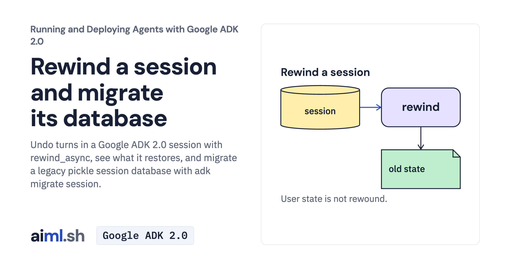

 [Running and Deploying Agents with Google ADK 2.0](../) · lesson 5 of 20

# Rewind a session and migrate its database

Undo turns in a Google ADK 2.0 session with rewind_async, see what it restores, and migrate a legacy pickle session database with adk migrate session.

- **Full lesson:** [https://aiml.sh/courses/google-adk-production/rewind-a-session-and-migrate-its-database/](https://aiml.sh/courses/google-adk-production/rewind-a-session-and-migrate-its-database/)
- **Reading time:** 25 min
- **Uses:** google-adk[db] 2.12.0 (SQLAlchemy for DatabaseSessionService and adk migrate); litellm 1.102.4 for the Ollama alternative

## Lab

The [`lab/`](lab/) folder holds the complete runnable code, tests and recorded outputs, the same files as the lesson's download on aiml.sh. The lesson explains each step.
