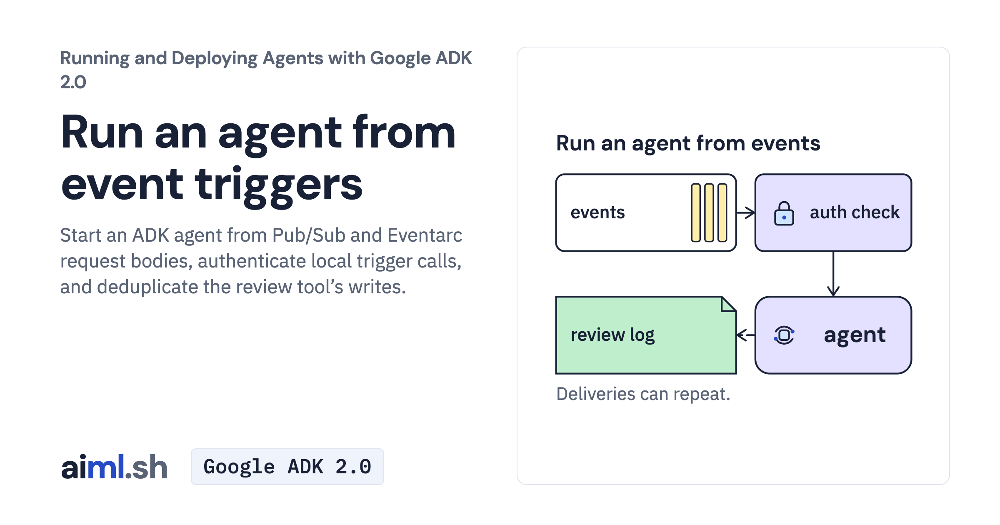

 [Running and Deploying Agents with Google ADK 2.0](../) · lesson 6 of 20

# Run an agent from event triggers

[](https://aiml.sh/courses/google-adk-production/run-an-agent-from-event-triggers/)

Start an ADK agent from Pub/Sub and Eventarc request bodies, authenticate local trigger calls, and deduplicate the review tool’s writes.

- **Full lesson:** [https://aiml.sh/courses/google-adk-production/run-an-agent-from-event-triggers/](https://aiml.sh/courses/google-adk-production/run-an-agent-from-event-triggers/)
- **Reading time:** 20 min
- **Uses:** google-adk 2.12.0 (includes FastAPI, uvicorn and httpx); litellm 1.102.4 for the Ollama alternative; filelock 4.2.4

## Lab

The [`lab/`](lab/) folder holds the complete runnable code, tests and recorded outputs, the same files as the lesson's download on aiml.sh. The lesson explains each step.

### Lab notes

#### Run an agent from event triggers

Run from this directory after installing `requirements-lock.txt` in your environment. Provider-backed commands require `GOOGLE_API_KEY` in the shell and incur model usage. The local environment must match the pinned dependencies; no install is performed by the example.

Run the server command below from the extracted lab directory, with `GOOGLE_API_KEY` in its shell. Keep that terminal running. Open a second terminal in the same directory for `publish.py`, using the same `TRIGGER_TOKEN` value. A successful delivery can make fresh model requests and append to the local `reviews.jsonl`; it does not publish to a cloud topic. `python main.py` constructs the ADK API app with this lesson's verifier, so a bare `adk run docs_reviewer` does not exercise the authentication or delivery routes.

##### Offline checks and saved evidence

```sh
python -m unittest -v test_triggers.py
```

These tests use controlled or recorded model responses; passing them is not a fresh model outcome. Existing `recorded-runs.json`, `run-output.txt` and `test-output.txt` retain their historical scope. `record.py` is a fresh experiment recorder, not an offline replay command; it may make provider calls and replace saved results. Do not run it to view existing evidence.

```sh
TRIGGER_TOKEN=local-dev-token python main.py
```

##### Deliver an event

With the server still running, use a second terminal in this directory:

```sh
TRIGGER_TOKEN=local-dev-token python publish.py pubsub tokens --message-id 1001
TRIGGER_TOKEN=local-dev-token python publish.py pubsub tokens --message-id 1001
TRIGGER_TOKEN=local-dev-token python publish.py eventarc rollback --event-id ev-77
```

The repeated Pub/Sub message tests redelivery. Both terminals must use the same token. Inspect `reviews.jsonl` rather than assuming HTTP success proves a correct review.

##### Actual execution

The 2026-10-25 recording sends actual HTTP requests to the local ADK app. Two Pub/Sub-shaped deliveries with the same ID returned HTTP 200 and kept one review row. The Eventarc-shaped delivery added its own review. Malformed base64 returned HTTP 400; a wrong shared token and a missing OIDC token returned HTTP 401. No cloud Pub/Sub or Eventarc delivery was exercised.

The current `recorded-runs.json` contains the actual sessions and model turns. [Execution receipt](lab/runs/docuctl-2026-10-25/receipt.json) binds the outputs to captured provider request and response hashes. Raw provider records are retained privately; opaque signatures are omitted from the public projection. This selected execution is not a reliability measurement.
