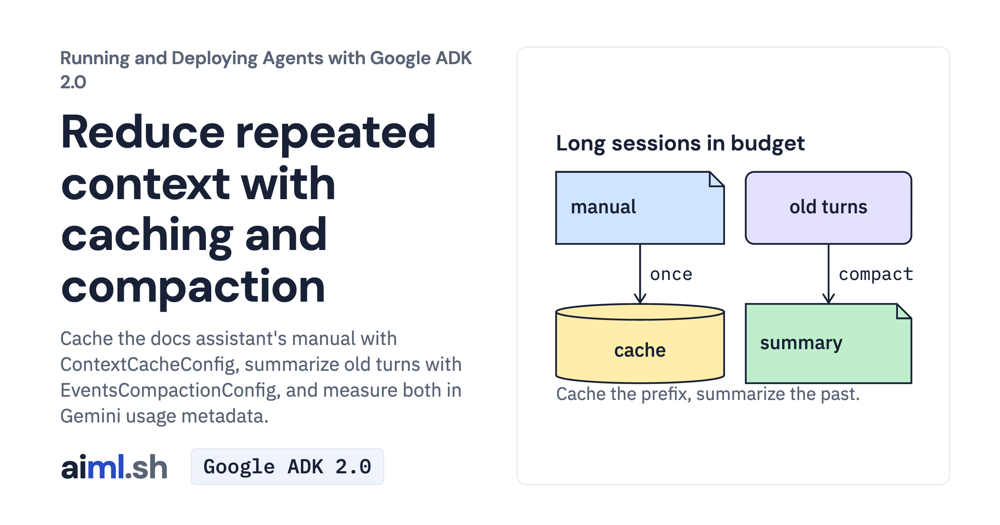

 [Running and Deploying Agents with Google ADK 2.0](../) · lesson 7 of 20

# Reduce repeated context with caching and compaction

Cache the docs assistant's manual with ContextCacheConfig, summarize old turns with EventsCompactionConfig, and measure both in Gemini usage metadata.

- **Full lesson:** [https://aiml.sh/courses/google-adk-production/keep-long-sessions-in-budget-with-compaction-and-context-caching/](https://aiml.sh/courses/google-adk-production/keep-long-sessions-in-budget-with-compaction-and-context-caching/)
- **Reading time:** 25 min
- **Uses:** google-adk 2.12.0; litellm 1.102.4 for the Ollama alternative

## Lab

The [`lab/`](lab/) folder holds the complete runnable code, tests and recorded outputs, the same files as the lesson's download on aiml.sh. The lesson explains each step.
