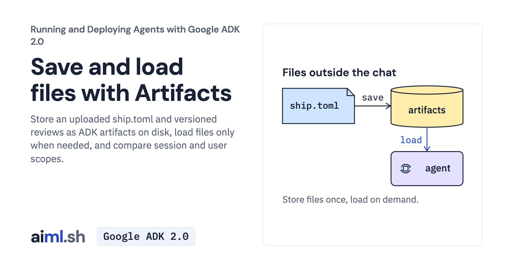

 [Running and Deploying Agents with Google ADK 2.0](../) · lesson 8 of 20

# Save and load files with Artifacts

[](https://aiml.sh/courses/google-adk-production/save-and-load-files-with-artifacts/)

Store an uploaded ship.toml and versioned reviews as ADK artifacts on disk, load files only when needed, and compare session and user scopes.

- **Full lesson:** [https://aiml.sh/courses/google-adk-production/save-and-load-files-with-artifacts/](https://aiml.sh/courses/google-adk-production/save-and-load-files-with-artifacts/)
- **Reading time:** 20 min
- **Uses:** google-adk 2.12.0; litellm 1.102.4 for the Ollama alternative

## Lab

The [`lab/`](lab/) folder holds the complete runnable code, tests and recorded outputs, the same files as the lesson's download on aiml.sh. The lesson explains each step.

### Lab notes

#### Save and load files with ADK artifacts

Install `requirements-lock.txt` in an isolated Python environment. Set `GOOGLE_API_KEY` privately before running the model-backed commands. Tests replay saved model turns offline.

##### Run the example

```sh
python assistant.py "Review this ship.toml before I deploy to production."
```

The assistant uploads the supplied configuration, reads it with `load_artifacts`, and checks it against the bundled docuctl manual. Files remain in the local artifact store. Model-backed runs incur API usage.

```sh
python -m unittest -v test_assistant.py
```

`python record.py` runs the multi-step experiment, makes fresh model calls and replaces the saved results. It is an authoring command, not an offline replay.

##### Recorded execution evidence

The recorder made real Gemini API calls and used the local tools and services in this lab. The [provider attempt metadata and output hashes](lab/runs/docuctl-2026-10-25/provenance.json) identify the recorded output and captured attempts. Raw provider receipts remain private; the download excludes opaque model signatures and SQLite binaries. These records do not demonstrate browser interaction or reliability across other questions. Run the offline tests to exercise the selected replies without making paid model calls.
