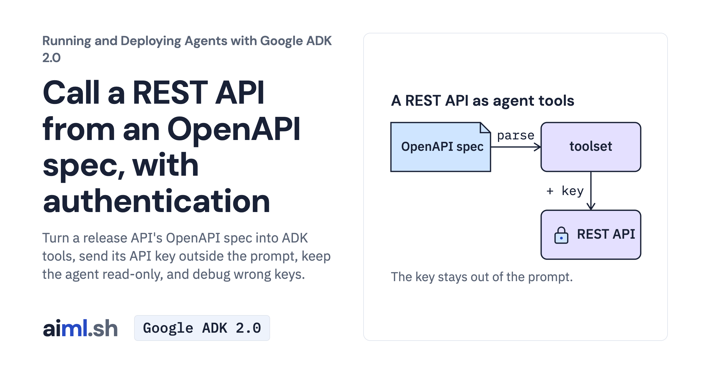

 [Running and Deploying Agents with Google ADK 2.0](../) · lesson 9 of 20

# Call a REST API from an OpenAPI spec, with authentication

[](https://aiml.sh/courses/google-adk-production/call-a-rest-api-from-an-openapi-spec-with-authentication/)

Turn a release API's OpenAPI spec into ADK tools, send its API key outside the prompt, keep the agent read-only, and debug wrong keys.

- **Full lesson:** [https://aiml.sh/courses/google-adk-production/call-a-rest-api-from-an-openapi-spec-with-authentication/](https://aiml.sh/courses/google-adk-production/call-a-rest-api-from-an-openapi-spec-with-authentication/)
- **Reading time:** 25 min
- **Uses:** google-adk, FastAPI, uvicorn and httpx; litellm for an existing Ollama model

## Lab

The [`lab/`](lab/) folder holds the complete runnable code, tests and recorded outputs, the same files as the lesson's download on aiml.sh. The lesson explains each step.

### Lab notes

#### Release API tools: native ADK and Python Runner

Python 3.12+. Use the complete extracted folder, including release_assistant/.
Docuctl is an original demonstration deployment CLI; the bundled release service is local sample data, not a production deployment API.

```bash
cd adk-openapi-auth
python3.12 -m venv .venv
source .venv/bin/activate
python -m pip install -r requirements-lock.txt
cp release_assistant/.env.example release_assistant/.env
```

Fill GOOGLE_API_KEY privately in release_assistant/.env. The file selects the Gemini API, not a cloud project. The example SHIP_API_KEY is a public local demonstration value, not a credential for a real service. Existing Ollama users may export DOCS_MODEL=ollama_chat/gemma4:e2b; no model download is included.

Terminal 1, from this project with the environment activated:

```bash
export SHIP_API_KEY=local-release-demo
uvicorn ship_api:app --host 127.0.0.1 --port 8766
```

Terminal 2, same project and environment:

```bash
source .venv/bin/activate
adk run release_assistant
```

At [user]: ask `Which staging releases failed?`. Check list_releases, its result and the answer. Type exit to finish. Loading and exiting makes no model request; sending a question does. With the API still running, use `adk web --host 127.0.0.1 --port 8768 .`, select release_assistant and start a session to inspect those events in the local Dev UI. Stop both servers with Ctrl-C.

release_assistant/agent.py exports App, and builds the same dynamic spec, filter, key credential and request-ID header as assistant.py. The API must be running before this package loads. No generic root_agent wrapper replaces its auth setup.

The Python Runner alternative needs exported GOOGLE_API_KEY, GOOGLE_GENAI_USE_ENTERPRISE=0, SHIP_API_KEY and optionally SHIP_API_URL: it does not automatically load the native package's .env.

```bash
python assistant.py "Which staging releases failed?"
```

Offline checks:

```bash
python -m unittest -v test_assistant.py test_native_entrypoint.py
```

These replay saved model turns against the real local service and check native App construction; they do not verify a fresh generated answer. The saved model responses are from the docuctl experiment. Native App construction is checked separately from model execution.

Optional author recording: `python record.py --record` starts its own service and makes multiple model requests before replacing saved files. Stop the manually started API first. Do this only in a separate copy when you intend to regenerate; running record.py without --record refuses.

Current syntax: https://adk.dev/runtime/command-line/ , https://adk.dev/runtime/web-interface/ , https://adk.dev/tools-custom/openapi-tools/ . Checked with installed google-adk 2.12.0.

##### Recorded execution evidence

The recorder made real Gemini API calls and used the local tools and services in this lab. The [provider attempt metadata and output hashes](lab/runs/docuctl-2026-10-25/provenance.json) identify the recorded output and captured attempts. Raw provider receipts remain private; the download excludes opaque model signatures and SQLite binaries. These records do not demonstrate browser interaction or reliability across other questions. Run the offline tests to exercise the selected replies without making paid model calls.
