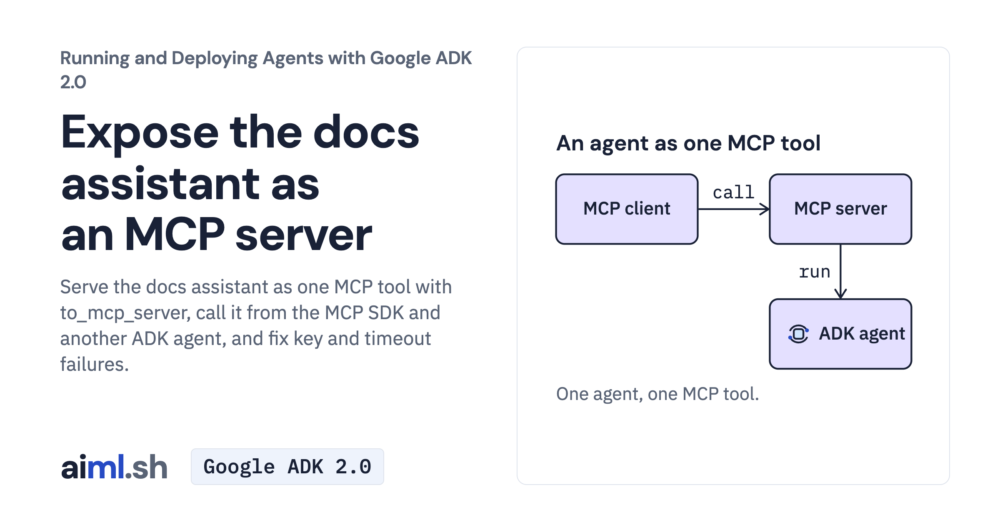

 [Running and Deploying Agents with Google ADK 2.0](../) · lesson 11 of 20

# Expose the docs assistant as an MCP server

[](https://aiml.sh/courses/google-adk-production/expose-the-docs-assistant-as-an-mcp-server/)

Serve the docs assistant as one MCP tool with to_mcp_server, call it from the MCP SDK and another ADK agent, and fix key and timeout failures.

- **Full lesson:** [https://aiml.sh/courses/google-adk-production/expose-the-docs-assistant-as-an-mcp-server/](https://aiml.sh/courses/google-adk-production/expose-the-docs-assistant-as-an-mcp-server/)
- **Reading time:** 25 min
- **Uses:** google-adk[mcp] 2.12.0 with mcp 1.30.0; litellm 1.102.4 for the Ollama alternative

## Lab

The [`lab/`](lab/) folder holds the complete runnable code, tests and recorded outputs, the same files as the lesson's download on aiml.sh. The lesson explains each step.

### Lab notes

#### Expose the docs assistant as an MCP server

Use the course Python environment and the pinned requirements-lock.txt. From this directory, run `python -m unittest -v test_server.py` for offline protocol, timeout and cleanup checks. These tests do not grade a fresh model answer.

To ask your own question, set GOOGLE_API_KEY and run:

```sh
python release_bot.py "Does rolling staging back undo its database migration?"
```

This is a real Python Runner with McpToolset. It starts server.py as a stdio child process, passes the key explicitly, and prints calls, results and the final answer as JSON. Both agents can call the model, so a question can cause multiple paid requests. Close the client normally so its Runner and toolset release the child process.

Do not start a second stdio server terminal. `python server.py` waits for protocol input and reserves stdout for MCP; it is not a chat console. `python server.py http` selects Streamable HTTP, which needs service authentication before network exposure. A direct adk run/web of root_agent skips MCP and is a different exercise.

The supplied `recorded-runs.json` and `run-output.txt` contain the recorded docuctl experiment. record.py runs a multi-case experiment with real model calls and overwrites those files; it is not an offline replay. Use a separate working copy for new recordings.

##### Recorded execution evidence

The recorder made real Gemini API calls and used the local tools and services in this lab. The [provider attempt metadata and output hashes](lab/runs/docuctl-2026-10-25/provenance.json) identify the recorded output and captured attempts. Raw provider receipts remain private; the download excludes opaque model signatures and SQLite binaries. These records do not demonstrate browser interaction or reliability across other questions. Run the offline tests to exercise the selected replies without making paid model calls.
