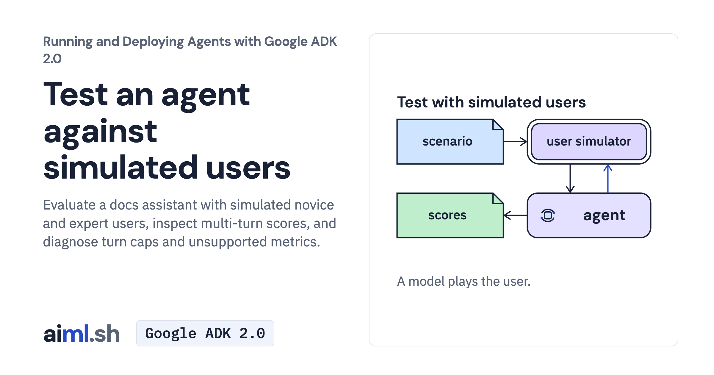

 [Running and Deploying Agents with Google ADK 2.0](../) · lesson 13 of 20

# Test an agent against simulated users

[](https://aiml.sh/courses/google-adk-production/test-an-agent-against-simulated-users/)

Evaluate a docs assistant with simulated novice and expert users, inspect multi-turn scores, and diagnose turn caps and unsupported metrics.

- **Full lesson:** [https://aiml.sh/courses/google-adk-production/test-an-agent-against-simulated-users/](https://aiml.sh/courses/google-adk-production/test-an-agent-against-simulated-users/)
- **Reading time:** 25 min
- **Uses:** google-adk[eval] 2.12.0

## Lab

The [`lab/`](lab/) folder holds the complete runnable code, tests and recorded outputs, the same files as the lesson's download on aiml.sh. The lesson explains each step.

### Lab notes

#### Evaluate simulated user conversations

Use the entire extracted lab directory, including docs, fixtures and tests. Python 3.12+ is required. Install the pinned environment with `python -m pip install -r requirements-lock.txt` in your own virtual environment. These instructions do not provision resources.

##### Run a fresh interaction

Set `GOOGLE_API_KEY` in your environment before running the command. Do not put the key in source files or output captures. Run from this directory:

```sh
ADK_DISABLE_LOAD_DOTENV=1 adk eval docs_assistant scenarios --config_file_path eval_config.json --print_detailed_results
```

The supplied docs_assistant/scenarios.evalset.json already contains the scenarios. Native adk eval runs both agent and simulated-user model calls; model-based metrics can add judge calls. results/ contains historical evaluations. Offline tests inspect those results rather than running new conversations.

These commands make fresh model requests and may incur provider charges. They are instructions for a learner's intentional run, not a claim that this repair executed a new model run. The lesson describes the existing saved recordings separately.

##### Verify offline

```sh
python -m unittest -v test_scenarios.py
```

These tests use saved records, replay models or deterministic local checks. Passing them does not establish current model behavior. Historical `test-output.txt` is retained; new regression tests can increase the current test count.

##### Preserve the supplied evidence

`record.py` runs a multi-case fresh-model experiment and overwrites saved output/results. Use a separate copy before running it. Supplied raw records and original media, where present, are historical evidence. An offline report view is not a fresh model execution. See the article for the mechanism, observed failures and official references.

##### Selected native evaluation, October 23, 2026

`runs/native-2026-10-23/` retains one original native `adk eval` execution of existing EXPERTcase6be7706e using unchanged eval_config.json. All15generationHTTPattempts (agent, simulator, bothjudges and anyretries) shared20cap/1024outputtokens; no rerun. The simulator generated a Pythonversion followup, then a stop response. Native results contain two turns and1.0sampled scores for hallucinations_v1 and per_turn_user_simulator_quality_v1, each threshold0.8. These scores do not guarantee correctness or reliability. OLLAMA_API_BASE and Python3.12 match this scenario's install.md fixture; no local model was launched.

Native inference3.5/tool2.5/token1368/duration6.911 informational scores are means per agent turn. They do not total the15nested HTTPrequests or their tokens and are not providerbilling figures. The additive observer labels7agent/2simulator/6judge SDKcalls heuristically; the locked HTTPledger is authoritative for attempts. Raw native EvalSetResult, nestedcall records, sourcehashes, original1920PNG/PTY and publicprojection inventory are supplied. Only opaqueJSONsignaturefields are omitted; originalmodeltext is preserved. No managed task-successmetric/cloud service or Web UI was run. Historicalresults remain unchanged.
