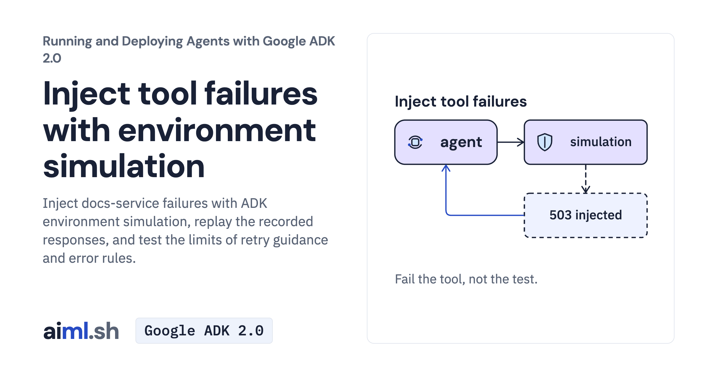

 [Running and Deploying Agents with Google ADK 2.0](../) · lesson 14 of 20

# Inject tool failures with environment simulation

[](https://aiml.sh/courses/google-adk-production/inject-tool-failures-with-environment-simulation/)

Inject docs-service failures with ADK environment simulation, replay the recorded responses, and test the limits of retry guidance and error rules.

- **Full lesson:** [https://aiml.sh/courses/google-adk-production/inject-tool-failures-with-environment-simulation/](https://aiml.sh/courses/google-adk-production/inject-tool-failures-with-environment-simulation/)
- **Reading time:** 25 min
- **Uses:** google-adk 2.12.0; litellm for the Ollama alternative

## Lab

The [`lab/`](lab/) folder holds the complete runnable code, tests and recorded outputs, the same files as the lesson's download on aiml.sh. The lesson explains each step.

### Lab notes

#### Ask one question under a chosen fault

Use the entire extracted lab directory, including docs, fixtures and tests. Python 3.12+ is required. Install the pinned environment with `python -m pip install -r requirements-lock.txt` in your own virtual environment. These instructions do not provision resources.

##### Run a fresh interaction

Set `GOOGLE_API_KEY` in your environment before running the command. Do not put the key in source files or output captures. Run from this directory:

```sh
python run.py "How do I use a local model instead of Gemini?" --fault outage --retry answer
```

run.py retains the simulation App, ON_ERROR instruction and selected retry plugin. Choose --fault none|outage|missing-page|flaky and --retry none|raise|answer. Faults are injected locally, while agent inference is fresh. A bare root_agent launcher would omit the plugins. The default is outage with no retry plugin. --retry raise can intentionally exit with RuntimeError after retry exhaustion.

These commands make fresh model requests and may incur provider charges. They are instructions for a learner's intentional run, not a claim that this repair executed a new model run. The lesson describes the existing saved recordings separately.

##### Verify offline

```sh
python -m unittest -v test_simulated.py
```

These tests use saved records, replay models or deterministic local checks. Passing them does not establish current model behavior. Historical `test-output.txt` is retained; new regression tests can increase the current test count.

##### Preserve the supplied evidence

`record.py` runs a multi-case fresh-model experiment and overwrites saved output/results. Use a separate copy before running it. Supplied raw records and original media, where present, are historical evidence. An offline report view is not a fresh model execution. See the article for the mechanism, observed failures and official references.

##### Selected fresh run, October 23, 2026

`runs/live-2026-10-23/` retains the actual Runner output, original live PTY PNG, per-request ledger, source hashes and field-only public JSON projection. The deterministic plugin returned read_page error_code503. The agent reported unavailable docs and declined installation instructions; no retry plugin or LLM-generated simulation was used. This selected run used 3 requests capped at 1024 output tokens each, without reruns. Historical recordings remain unchanged.
