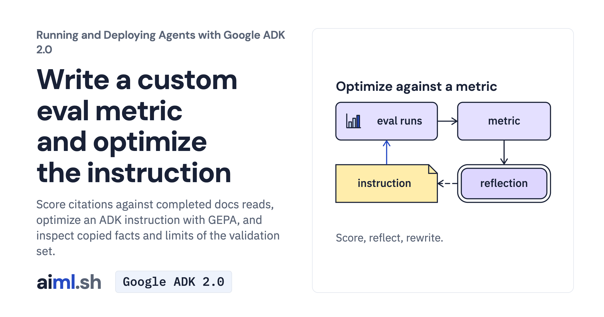

 [Running and Deploying Agents with Google ADK 2.0](../) · lesson 15 of 20

# Write a custom eval metric and optimize the instruction

Score citations against completed docs reads, optimize an ADK instruction with GEPA, and inspect copied facts and limits of the validation set.

- **Full lesson:** [https://aiml.sh/courses/google-adk-production/write-a-custom-eval-metric-and-optimize-the-instruction/](https://aiml.sh/courses/google-adk-production/write-a-custom-eval-metric-and-optimize-the-instruction/)
- **Reading time:** 30 min
- **Uses:** google-adk[eval] 2.12.0

## Lab

The [`lab/`](lab/) folder holds the complete runnable code, tests and recorded outputs, the same files as the lesson's download on aiml.sh. The lesson explains each step.
