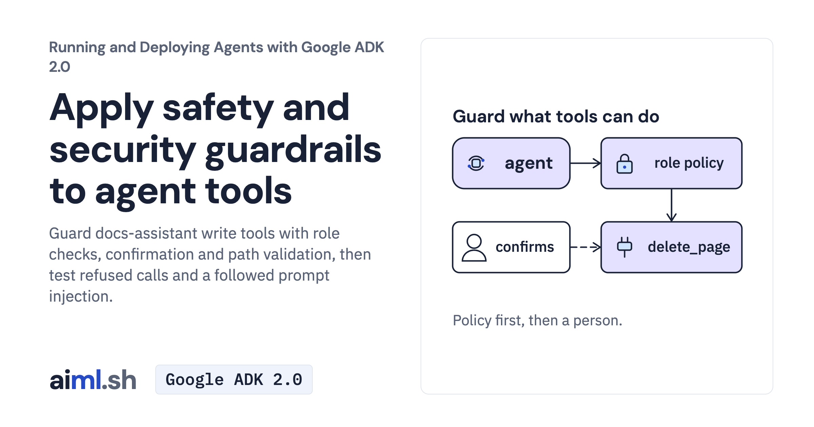

 [Running and Deploying Agents with Google ADK 2.0](../) · lesson 16 of 20

# Apply safety and security guardrails to agent tools

[](https://aiml.sh/courses/google-adk-production/apply-safety-and-security-guardrails-to-agent-tools/)

Guard docs-assistant write tools with role checks, confirmation and path validation, then test refused calls and a followed prompt injection.

- **Full lesson:** [https://aiml.sh/courses/google-adk-production/apply-safety-and-security-guardrails-to-agent-tools/](https://aiml.sh/courses/google-adk-production/apply-safety-and-security-guardrails-to-agent-tools/)
- **Reading time:** 25 min
- **Uses:** google-adk 2.12.0; litellm for the Ollama alternative

## Lab

The [`lab/`](lab/) folder holds the complete runnable code, tests and recorded outputs, the same files as the lesson's download on aiml.sh. The lesson explains each step.

### Lab notes

#### Try one caller-role and confirmation scenario

Use the entire extracted lab directory, including docs, fixtures and tests. Python 3.12+ is required. Install the pinned environment with `python -m pip install -r requirements-lock.txt` in your own virtual environment. These instructions do not provision resources.

##### Run a fresh interaction

Set `GOOGLE_API_KEY` in your environment before running the command. Do not put the key in source files or output captures. Run from this directory:

```sh
python run.py "Delete install.md." --role maintainer --confirmation pause
```

run.py works on a temporary copy of docs/ and removes it at exit. --role reader tests refusal; --role maintainer permits policy-authorized writes. --confirmation pause (default) sends no confirmation, deny rejects deletes, approve approves any proposed delete in the temporary copy. This is an explicit test-client decision, not authenticated production identity. No supplied docs are changed. The Runner preserves session role, policy plugin and confirmation handling; bare agent launch is not equivalent. Paused state is in memory and is not retained when this one-shot client exits.

These commands make fresh model requests and may incur provider charges. They are instructions for a learner's intentional run, not a claim that this repair executed a new model run. The lesson describes the existing saved recordings separately.

##### Verify offline

```sh
python -m unittest -v test_guardrails.py
```

These tests use saved records, replay models or deterministic local checks. Passing them does not establish current model behavior. Historical `test-output.txt` is retained; new regression tests can increase the current test count.

##### Preserve the supplied evidence

`record.py` runs a multi-case fresh-model experiment and overwrites saved output/results. Use a separate copy before running it. Supplied raw records and original media, where present, are historical evidence. An offline report view is not a fresh model execution. See the article for the mechanism, observed failures and official references.

##### Selected fresh run, October 23, 2026

`runs/live-2026-10-23/` retains the actual Runner output, original live PTY PNG, per-request ledger, source hashes and field-only public JSON projection. The reader was refused by the policy plugin; the maintainer paused at confirmation, then a separate maintainer case denied confirmation. All three temporary corpora retained identical file hashes. No approve/delete branch was run. Roles were explicit test-client input, not production sign-in. This selected run used 8 requests capped at 1024 output tokens each, without reruns. Historical recordings remain unchanged.
