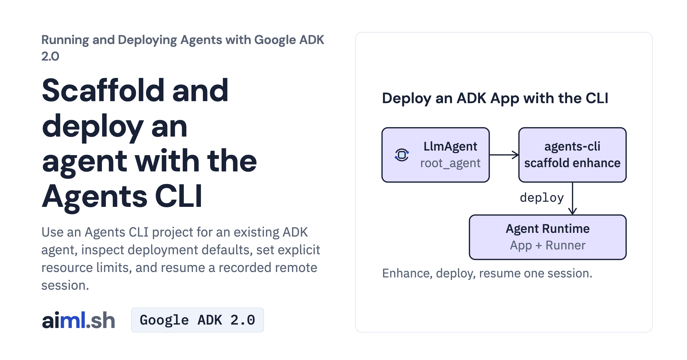

 [Running and Deploying Agents with Google ADK 2.0](../) · lesson 18 of 20

# Scaffold and deploy an agent with the Agents CLI

Use an Agents CLI project for an existing ADK agent, inspect deployment defaults, set explicit resource limits, and resume a recorded remote session.

- **Full lesson:** [https://aiml.sh/courses/google-adk-production/scaffold-and-deploy-an-agent-with-the-agents-cli/](https://aiml.sh/courses/google-adk-production/scaffold-and-deploy-an-agent-with-the-agents-cli/)
- **Reading time:** 20 min
- **Uses:** Google ADK 2.12.0; Agents CLI 1.11.0; the downloaded uv.lock

## Lab

The [`lab/`](lab/) folder holds the complete runnable code, tests and recorded outputs, the same files as the lesson's download on aiml.sh. The lesson explains each step.

### Lab notes

#### Agents CLI project for the docs assistant

This lab contains the docuctl agent, generated serving adapters, manifest and uv.lock. Fresh Agents CLI 1.11.0 recordings show enhancement of the same agent source, deployment of this bundled project and a remote conversation with continuation. Generic demo evals and placeholder tests are omitted; test_project.py supplies the local checks for this lab. The unique deployment and its dedicated runtime identity were deleted after recording. Live deployment_metadata.json is intentionally omitted; the example file is a shape reference.

Use Python 3.11–3.13 and uv for this generated project. Install Google Agents CLI 1.11.0 as a tool in its own environment. `uv sync` uses the included project lock. Offline project checks: `python -m unittest -v test_project.py` in the course's pinned ADK environment, with agents-cli on PATH. The checks inspect project files, CLI help and a local flag rejection; they do not deploy or call a model.

Review agents-cli-manifest.yaml before a separately approved deployment. `agents-cli deploy --dry-run --project YOUR_PROJECT --region us-central1` performs Google Cloud validation, so it is not an offline check. Set explicit resource limits for a real create. The saved deploy used --cpu 1 --memory 1Gi --min-instances 0 --max-instances 1 --no-agent-identity; the recorded CLI defaults differ. Identity choice does not remove cloud IAM requirements.

The run218 and run218b recordings show one remote conversation and continuation; model reliability was not evaluated. Do not ship another user's deployment metadata or delete it merely to turn a failed update into a new create. Keep the created resource ID for teardown, and delete only the lesson-owned deployment after use.

The agent bounds each invocation to four model calls and each generated response to 1,024 tokens. These limits constrain this example; they are not a project billing cap.
