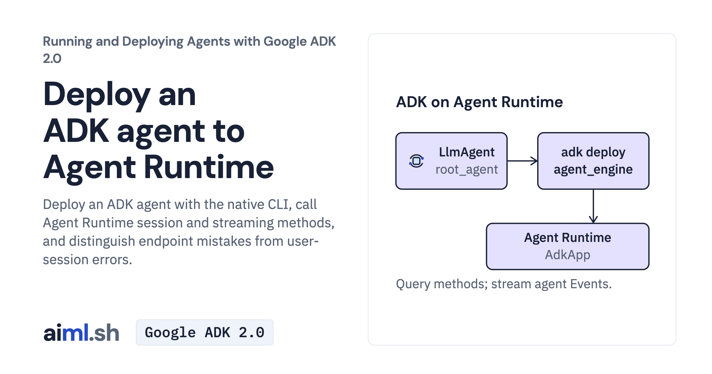

 [Running and Deploying Agents with Google ADK 2.0](../) · lesson 19 of 20

# Deploy an ADK agent to Agent Runtime

Deploy an ADK agent with the native CLI, call Agent Runtime session and streaming methods, and distinguish endpoint mistakes from user-session errors.

- **Full lesson:** [https://aiml.sh/courses/google-adk-production/deploy-an-adk-agent-to-agent-runtime/](https://aiml.sh/courses/google-adk-production/deploy-an-adk-agent-to-agent-runtime/)
- **Reading time:** 20 min
- **Uses:** google-adk[gcp] 2.12.0; google-cloud-aiplatform 2.6.0

## Lab

The [`lab/`](lab/) folder holds the complete runnable code, tests and recorded outputs, the same files as the lesson's download on aiml.sh. The lesson explains each step.

### Lab notes

#### Native ADK Agent Runtime deployment

The 2026-10-25 recording deployed the current docuctl assistant, queried it through the Agent Runtime REST surface and tested the invalid streaming-method and user/session requests. The unique instance and dedicated runtime service account were deleted after the run.

Install requirements-lock.txt in Python 3.12+. Offline checks: `python -m unittest -v test_runtime.py`; these do not create or query a cloud deployment. REST scripts need bash, gcloud, curl and jq.

For a separately approved reproduction, choose your project and region, configure ADC, and inspect docs_helper/.agent_engine_config.json. The native command is `adk deploy agent_engine --project YOUR_PROJECT --region us-central1 --display_name docs-helper docs_helper`. Use the backend/environment for ADC, without a Gemini API key. This creates a new instance unless --agent_engine_id selects an existing one. Do not overwrite an unrelated deployment.

With your returned ID, `PROJECT_ID=YOUR_PROJECT RESOURCE_ID=YOUR_ENGINE_ID bash query.sh` creates sessions, streams replies and polls memory. failures.sh deliberately sends invalid requests; it is not the ordinary client. Before using delete.sh, inspect the exact resource and confirm it carries the lesson ownership label. Its force deletion removes sessions and memories too. Wait for completion, and remove only resources created for this exercise.

The local SDK/configuration checks and the saved cloud run answer different questions. Neither is a task-accuracy evaluation.
