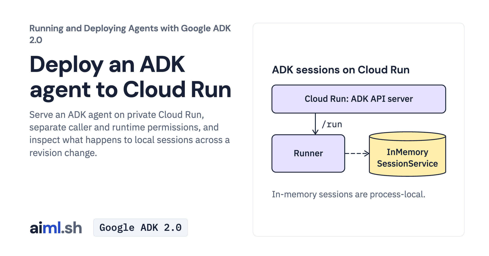

 [Running and Deploying Agents with Google ADK 2.0](../) · lesson 20 of 20

# Deploy an ADK agent to Cloud Run

Serve an ADK agent on private Cloud Run, separate caller and runtime permissions, and inspect what happens to local sessions across a revision change.

- **Full lesson:** [https://aiml.sh/courses/google-adk-production/deploy-an-adk-agent-to-cloud-run/](https://aiml.sh/courses/google-adk-production/deploy-an-adk-agent-to-cloud-run/)
- **Reading time:** 20 min
- **Uses:** google-adk[gcp] 2.12.0; google-cloud-aiplatform 2.6.0

## Lab

The [`lab/`](lab/) folder holds the complete runnable code, tests and recorded outputs, the same files as the lesson's download on aiml.sh. The lesson explains each step.

### Lab notes

#### Private Cloud Run ADK service

The 2026-10-25 recordings show caller rejection and missing model permission on a first temporary service, then successful docuctl answers and session loss after a new revision on a second service. Both services and their dedicated identities were removed.

Install requirements-lock.txt in Python 3.12+. The shell client needs bash, gcloud, curl and jq. Offline checks: `python -m unittest -v test_client.py`; fake curl/gcloud executables exercise the real request.sh without Google Cloud access.

A cloud reproduction needs an approved project, ADC, a runtime service account and the caller/runtime permissions agreed for that project. Inspect deploy-output.txt for the native ADK command and explicit resource limits; values and account names belong to that earlier exercise. Do not run the historical IAM or delete commands as a setup script.

Call your service with `SERVICE_URL=https://YOUR_SERVICE bash request.sh 'question'`; set SESSION to continue a session. Each client uses a private temporary response file and exits nonzero on failed session creation or run. The current client bounds each turn to four model calls. The fresh service run used that same call bound and 1,024 output tokens per model call.

Local session storage does not survive every instance/revision replacement. Configure and test a managed store if the application needs durable conversations. Track the service, source upload bucket, image and any newly created account. Delete only resources this exercise created, after confirming they are not shared.
