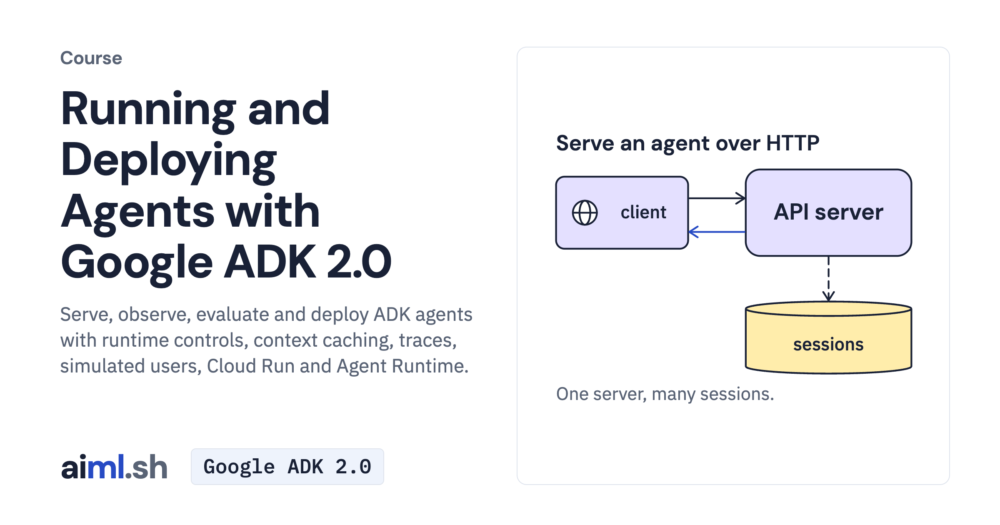

#  Running and Deploying Agents with Google ADK 2.0

Serve, observe, evaluate and deploy ADK agents with runtime controls, context caching, traces, simulated users, Cloud Run and Agent Runtime.

- **Course on aiml.sh:** [https://aiml.sh/courses/google-adk-production/](https://aiml.sh/courses/google-adk-production/)
- **Lessons:** 20 · **Reading time:** about 8 hours
- **Prerequisites:** Python, HTTP and JSON, and the Building Agents with Google ADK 2.0 course.
- **Framework:** Google ADK 2.0

## What you'll learn

- Serve an agent over HTTP, tune runs with RunConfig, and resume, rewind or migrate sessions.
- Run an agent from Pub/Sub and Eventarc deliveries behind an auth check.
- Reuse cached prompt prefixes, compact conversation history, store artifacts and call REST APIs from an OpenAPI spec.
- Trace runs with OpenTelemetry, test against simulated users, and put identity, policy and confirmation guardrails around tools.
- Inspect Agents CLI project deployment, then deploy agents to Cloud Run and Agent Runtime with ADK deployment commands.

## Lessons

| # | Lesson | Time | Code | Full lesson |
|---|---|---|---|---|
| 1 | [Serve an agent over HTTP and drive it from the CLI](01-serve-an-agent-over-http-and-drive-it-from-the-cli/) | 20&nbsp;min | [lab](01-serve-an-agent-over-http-and-drive-it-from-the-cli/lab/) | [read](https://aiml.sh/courses/google-adk-production/serve-an-agent-over-http-and-drive-it-from-the-cli/) |
| 2 | [Configure an ADK agent with YAML](02-build-an-agent-as-yaml-config-and-in-visual-builder/) | 20&nbsp;min | [lab](02-build-an-agent-as-yaml-config-and-in-visual-builder/lab/) | [read](https://aiml.sh/courses/google-adk-production/build-an-agent-as-yaml-config-and-in-visual-builder/) |
| 3 | [Tune a run with RunConfig and read the event loop](03-tune-a-run-with-runconfig-and-read-the-event-loop/) | 20&nbsp;min | [lab](03-tune-a-run-with-runconfig-and-read-the-event-loop/lab/) | [read](https://aiml.sh/courses/google-adk-production/tune-a-run-with-runconfig-and-read-the-event-loop/) |
| 4 | [Resume an interrupted agent run](04-resume-an-interrupted-agent-run/) | 20&nbsp;min | [lab](04-resume-an-interrupted-agent-run/lab/) | [read](https://aiml.sh/courses/google-adk-production/resume-an-interrupted-agent-run/) |
| 5 | [Rewind a session and migrate its database](05-rewind-a-session-and-migrate-its-database/) | 25&nbsp;min | [lab](05-rewind-a-session-and-migrate-its-database/lab/) | [read](https://aiml.sh/courses/google-adk-production/rewind-a-session-and-migrate-its-database/) |
| 6 | [Run an agent from event triggers](06-run-an-agent-from-event-triggers/) | 20&nbsp;min | [lab](06-run-an-agent-from-event-triggers/lab/) | [read](https://aiml.sh/courses/google-adk-production/run-an-agent-from-event-triggers/) |
| 7 | [Reduce repeated context with caching and compaction](07-keep-long-sessions-in-budget-with-compaction-and-context-caching/) | 25&nbsp;min | [lab](07-keep-long-sessions-in-budget-with-compaction-and-context-caching/lab/) | [read](https://aiml.sh/courses/google-adk-production/keep-long-sessions-in-budget-with-compaction-and-context-caching/) |
| 8 | [Save and load files with Artifacts](08-save-and-load-files-with-artifacts/) | 20&nbsp;min | [lab](08-save-and-load-files-with-artifacts/lab/) | [read](https://aiml.sh/courses/google-adk-production/save-and-load-files-with-artifacts/) |
| 9 | [Call a REST API from an OpenAPI spec, with authentication](09-call-a-rest-api-from-an-openapi-spec-with-authentication/) | 25&nbsp;min | [lab](09-call-a-rest-api-from-an-openapi-spec-with-authentication/lab/) | [read](https://aiml.sh/courses/google-adk-production/call-a-rest-api-from-an-openapi-spec-with-authentication/) |
| 10 | [Make tools parallel-ready](10-make-tools-parallel-ready/) | 20&nbsp;min | [lab](10-make-tools-parallel-ready/lab/) | [read](https://aiml.sh/courses/google-adk-production/make-tools-parallel-ready/) |
| 11 | [Expose the docs assistant as an MCP server](11-expose-the-docs-assistant-as-an-mcp-server/) | 25&nbsp;min | [lab](11-expose-the-docs-assistant-as-an-mcp-server/lab/) | [read](https://aiml.sh/courses/google-adk-production/expose-the-docs-assistant-as-an-mcp-server/) |
| 12 | [Trace and measure agent runs with OpenTelemetry](12-trace-and-measure-agent-runs-with-opentelemetry/) | 25&nbsp;min | [lab](12-trace-and-measure-agent-runs-with-opentelemetry/lab/) | [read](https://aiml.sh/courses/google-adk-production/trace-and-measure-agent-runs-with-opentelemetry/) |
| 13 | [Test an agent against simulated users](13-test-an-agent-against-simulated-users/) | 25&nbsp;min | [lab](13-test-an-agent-against-simulated-users/lab/) | [read](https://aiml.sh/courses/google-adk-production/test-an-agent-against-simulated-users/) |
| 14 | [Inject tool failures with environment simulation](14-inject-tool-failures-with-environment-simulation/) | 25&nbsp;min | [lab](14-inject-tool-failures-with-environment-simulation/lab/) | [read](https://aiml.sh/courses/google-adk-production/inject-tool-failures-with-environment-simulation/) |
| 15 | [Write a custom eval metric and optimize the instruction](15-write-a-custom-eval-metric-and-optimize-the-instruction/) | 30&nbsp;min | [lab](15-write-a-custom-eval-metric-and-optimize-the-instruction/lab/) | [read](https://aiml.sh/courses/google-adk-production/write-a-custom-eval-metric-and-optimize-the-instruction/) |
| 16 | [Apply safety and security guardrails to agent tools](16-apply-safety-and-security-guardrails-to-agent-tools/) | 25&nbsp;min | [lab](16-apply-safety-and-security-guardrails-to-agent-tools/lab/) | [read](https://aiml.sh/courses/google-adk-production/apply-safety-and-security-guardrails-to-agent-tools/) |
| 17 | [Use Agent Platform models, sessions and Memory Bank](17-use-agent-platform-models-sessions-and-memory-bank/) | 20&nbsp;min | [lab](17-use-agent-platform-models-sessions-and-memory-bank/lab/) | [read](https://aiml.sh/courses/google-adk-production/use-agent-platform-models-sessions-and-memory-bank/) |
| 18 | [Scaffold and deploy an agent with the Agents CLI](18-scaffold-and-deploy-an-agent-with-the-agents-cli/) | 20&nbsp;min | [lab](18-scaffold-and-deploy-an-agent-with-the-agents-cli/lab/) | [read](https://aiml.sh/courses/google-adk-production/scaffold-and-deploy-an-agent-with-the-agents-cli/) |
| 19 | [Deploy an ADK agent to Agent Runtime](19-deploy-an-adk-agent-to-agent-runtime/) | 20&nbsp;min | [lab](19-deploy-an-adk-agent-to-agent-runtime/lab/) | [read](https://aiml.sh/courses/google-adk-production/deploy-an-adk-agent-to-agent-runtime/) |
| 20 | [Deploy an ADK agent to Cloud Run](20-deploy-an-adk-agent-to-cloud-run/) | 20&nbsp;min | [lab](20-deploy-an-adk-agent-to-cloud-run/lab/) | [read](https://aiml.sh/courses/google-adk-production/deploy-an-adk-agent-to-cloud-run/) |

Each lesson folder has a short summary, its diagram and its lab. The complete lesson, with explanations, recorded results and checks, is on aiml.sh.

[Back to all courses](../../README.md#courses)
