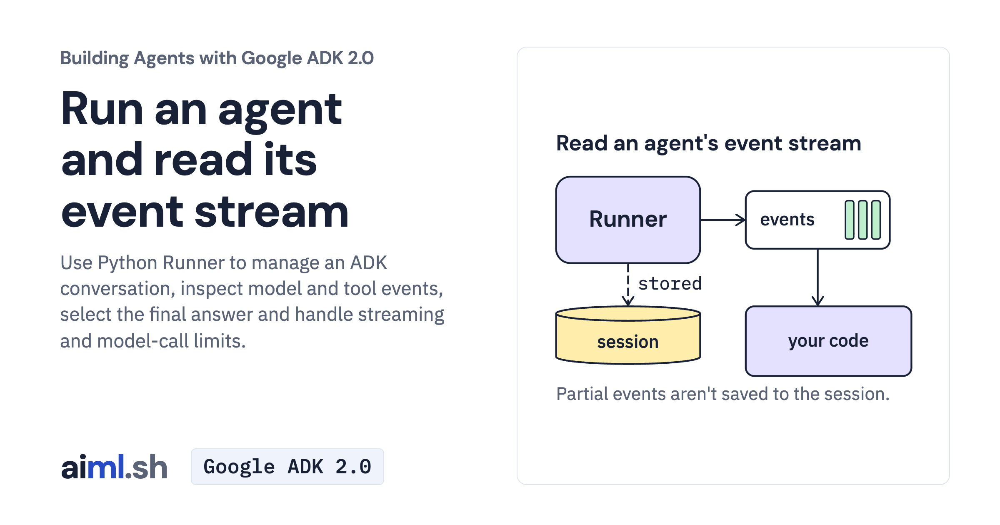

 [Building Agents with Google ADK 2.0](../) · lesson 2 of 17

# Run an agent and read its event stream

[](https://aiml.sh/courses/google-adk/run-an-agent-from-python-and-read-its-event-stream/)

Use Python Runner to manage an ADK conversation, inspect model and tool events, select the final answer and handle streaming and model-call limits.

- **Full lesson:** [https://aiml.sh/courses/google-adk/run-an-agent-from-python-and-read-its-event-stream/](https://aiml.sh/courses/google-adk/run-an-agent-from-python-and-read-its-event-stream/)
- **Reading time:** 20 min
- **Uses:** google-adk 2.12.0, litellm and python-dotenv

## Lab

The [`lab/`](lab/) folder holds the complete runnable code, tests and recorded outputs, the same files as the lesson's download on aiml.sh. The lesson explains each step.

### Lab notes

#### Run an agent and read its event stream

Terminal chat is enough to try an agent. A documentation portal needs application code that receives a question, manages the conversation and decides which response to display. We will give our docuctl assistant a Python `Runner` and inspect the events it returns.

Use Python 3.12 or later. All commands run from `adk-event-stream-lesson`.

##### Prepare the event-stream project

```bash
python3 -m venv .venv
source .venv/bin/activate
python -m pip install -r requirements.txt
cp .env.example .env
```

Edit the private root `.env` and replace its placeholder with your Gemini API key. The entrypoint loads it before constructing the agent; exported shell settings take precedence. Keep `.env` out of version control. Chat commands use your provider account.

##### Ask a question and print its events

```bash
python ask.py "How do I undo the last production deploy?" --max-llm-calls 2
```

##### Compare partial events with the completed response

```bash
python ask.py "How do I undo the last production deploy?" --stream --max-llm-calls 2
```

##### Run the offline event tests

```bash
python -m unittest -v test_ask.py
```

##### What to inspect

The Python Runner owns this activity. It prints collected events after the invocation, including partial events when --stream is selected; it is not a live-streaming UI. A final response must also be from an author other than user. Sessions are in memory. Optional Web inspection: run `adk web --host 127.0.0.1 --port 8000 .` and select docs_assistant; this starts a separate conversation.

##### Offline data

The bundled JSON contains saved model turns for replay tests and small teaching examples. These are saved-response replays, not new inference. Test commands replace the model while exercising the actual SDK mechanisms. Model wording in your own conversations can differ.

##### Record new model responses

With your Gemini API key set, run `python record.py`. This makes paid model requests for both Runner modes and writes `recorded-events.json`. The offline tests then replay those replies; they do not make new model requests.

##### Recorded execution evidence

The recorder made real Gemini API calls and used the local tools and services in this lab. The [provider attempt metadata and output hashes](lab/runs/docuctl-2026-10-25/provenance.json) identify the recorded output and captured attempts. Raw provider receipts remain private; the download excludes opaque model signatures and SQLite binaries. These records do not demonstrate browser interaction or reliability across other questions. Run the offline tests to exercise the selected replies without making paid model calls.
