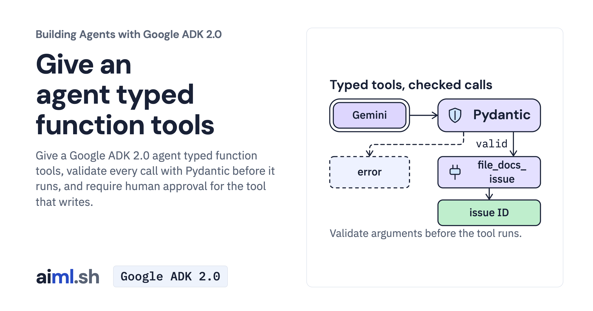

 [Building Agents with Google ADK 2.0](../) · lesson 3 of 17

# Give an agent typed function tools

[](https://aiml.sh/courses/google-adk/add-typed-function-tools/)

Give a Google ADK 2.0 agent typed function tools, validate every call with Pydantic before it runs, and require human approval for the tool that writes.

- **Full lesson:** [https://aiml.sh/courses/google-adk/add-typed-function-tools/](https://aiml.sh/courses/google-adk/add-typed-function-tools/)
- **Reading time:** 25 min
- **Uses:** google-adk 2.12.0, litellm and python-dotenv

## Lab

The [`lab/`](lab/) folder holds the complete runnable code, tests and recorded outputs, the same files as the lesson's download on aiml.sh. The lesson explains each step.

### Lab notes

#### Give an agent typed function tools

Our docs assistant can read a page. Now a developer wants it to file a documentation issue. Reading is one operation; writing requires valid arguments and a person's approval. We will add those two checks before a proposed issue reaches the local tracker.

Use Python 3.12 or later. All commands run from `adk-function-tools-lesson`.

##### Prepare the function-tool project

```bash
python3 -m venv .venv
source .venv/bin/activate
python -m pip install -r requirements.txt
cp .env.example .env
```

Edit the private root `.env` and replace its placeholder with your Gemini API key. The entrypoint loads it before constructing the agent; exported shell settings take precedence. Keep `.env` out of version control. Chat commands use your provider account.

##### Inspect a proposed issue before approving it

```bash
python agent.py "Read the tokens page, then file an unclear issue with the summary: Token expiry details are unclear."
```

##### Use the same agent without a write

```bash
python agent.py "Find the rollback page and summarize it. Do not file an issue."
```

##### Run argument and confirmation checks

```bash
python -m unittest -v test_agent.py test_cleanup.py
```

##### What to inspect

The approval prompt shows the proposed tool name and arguments. Enter n first to decline; rerun and enter y to accept a correct proposal. ISSUES is a process-local list and resets on restart. Pydantic validates before confirmation. A valid proposal still needs human review against the documentation.

##### Offline data

The bundled JSON contains saved model turns for replay tests and small teaching examples. These are saved-response replays, not new inference. Test commands replace the model while exercising the actual SDK mechanisms. Model wording in your own conversations can differ.
