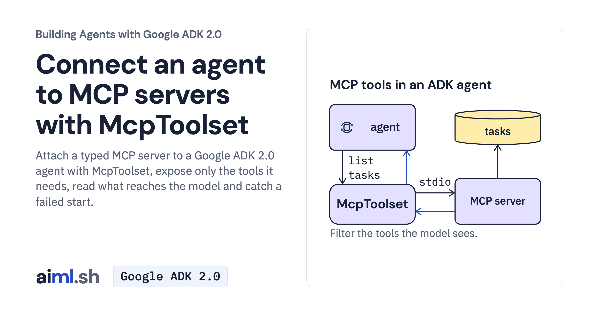

 [Building Agents with Google ADK 2.0](../) · lesson 4 of 17

# Connect an agent to MCP servers with McpToolset

[](https://aiml.sh/courses/google-adk/connect-an-agent-to-mcp-servers-with-mcptoolset/)

Attach a typed MCP server to a Google ADK 2.0 agent with McpToolset, expose only the tools it needs, read what reaches the model and catch a failed start.

- **Full lesson:** [https://aiml.sh/courses/google-adk/connect-an-agent-to-mcp-servers-with-mcptoolset/](https://aiml.sh/courses/google-adk/connect-an-agent-to-mcp-servers-with-mcptoolset/)
- **Reading time:** 20 min
- **Uses:** google-adk[mcp] 2.12.0, litellm and python-dotenv

## Lab

The [`lab/`](lab/) folder holds the complete runnable code, tests and recorded outputs, the same files as the lesson's download on aiml.sh. The lesson explains each step.

### Lab notes

#### Connect an agent to MCP servers with McpToolset

Another team already maintains a task tracker as an MCP server. Your docuctl assistant needs to find and add documentation tasks, but should not duplicate the server's tools or expose its task-completion operation. We will connect that server through ADK's `McpToolset` and select the two tools this assistant needs.

Use Python 3.12 or later. All commands run from `adk-mcp-toolset-lesson`.

##### Prepare the local MCP client and server

```bash
python3 -m venv .venv
source .venv/bin/activate
python -m pip install -r requirements.txt
cp .env.example .env
```

Edit the private root `.env` and replace its placeholder with your Gemini API key. The entrypoint loads it before constructing the agent; exported shell settings take precedence. Keep `.env` out of version control. Chat commands use your provider account.

##### Discover tools without calling Gemini

```bash
python agent.py --tools
```

##### Use the tracker through the Python Runner

```bash
python agent.py "List the open tasks. If none already covers it, add a normal-priority task titled Clarify rollback migration warning."
```

##### Check the excluded operation

```bash
python agent.py "Mark task T-1 as done."
```

##### Run the MCP contract and failure tests

```bash
python -m unittest -v test_agent.py output_cap_check.py
```

##### What to inspect

Run --tools before a model question. It starts the actual local stdio child without calling Gemini, then closes it. The agent exposes list_tasks and add_task, not complete_task. tool_filter is a client choice, not server authorization. Task writes last only for this server process. Stdio is started by the client; do not start another server terminal.

##### Offline data

The bundled JSON contains saved model turns for replay tests and small teaching examples. These are saved-response replays, not new inference. Test commands replace the model while exercising the actual SDK mechanisms. Model wording in your own conversations can differ.
