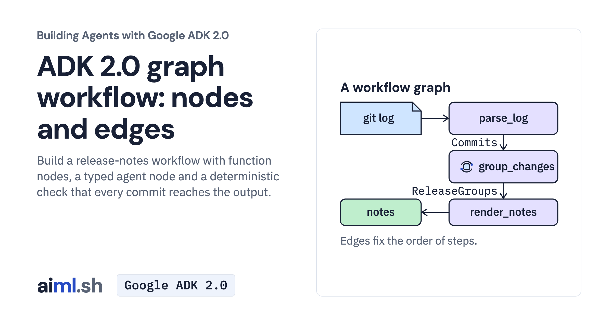

 [Building Agents with Google ADK 2.0](../) · lesson 7 of 17

# Build a graph workflow from nodes and edges

[](https://aiml.sh/courses/google-adk/build-a-graph-workflow-from-nodes-and-edges/)

Build a release-notes workflow with function nodes, a typed agent node and a deterministic check that every commit reaches the output.

- **Full lesson:** [https://aiml.sh/courses/google-adk/build-a-graph-workflow-from-nodes-and-edges/](https://aiml.sh/courses/google-adk/build-a-graph-workflow-from-nodes-and-edges/)
- **Reading time:** 20 min
- **Uses:** google-adk 2.12.0 with google-genai 2.32.0

## Lab

The [`lab/`](lab/) folder holds the complete runnable code, tests and recorded outputs, the same files as the lesson's download on aiml.sh. The lesson explains each step.

### Lab notes

#### Build a graph workflow from nodes and edges

Use Python 3.12 or later. Keep the files together and run commands from `adk-graph-workflow-lesson/`.

##### Set up

```bash
python3 -m venv .venv
source .venv/bin/activate
python -m pip install -r requirements.txt
```

On Windows PowerShell, activate with `.venv\Scripts\Activate.ps1`.

Export `GOOGLE_API_KEY` privately in this terminal. `.env.example` is an export
reference; the Python client does not load it. Then select the Gemini API:

```bash
unset GOOGLE_GENAI_USE_VERTEXAI DOCS_MODEL
export GOOGLE_GENAI_USE_ENTERPRISE=0
```

##### Run the activity

```bash
python graph_client.py
```

Inspect each event's `author`, `node_info` and final `message`. Every subject in
`sample-log.txt` should appear once. The membership check does not judge the best
category. Use `python graph_client.py --input my-log.txt` for another log.

Model-backed activity uses your provider account. The model configuration limits
each response to 1,024 output tokens.

##### Check offline

```bash
python -m unittest -v test_release_notes.py test_client.py
```

These checks exercise the actual code with saved replies or explicit fakes. They
make no provider requests. Saved replies illustrate the mechanism; use new cases
and inspect actual answers to evaluate a changed prompt.
