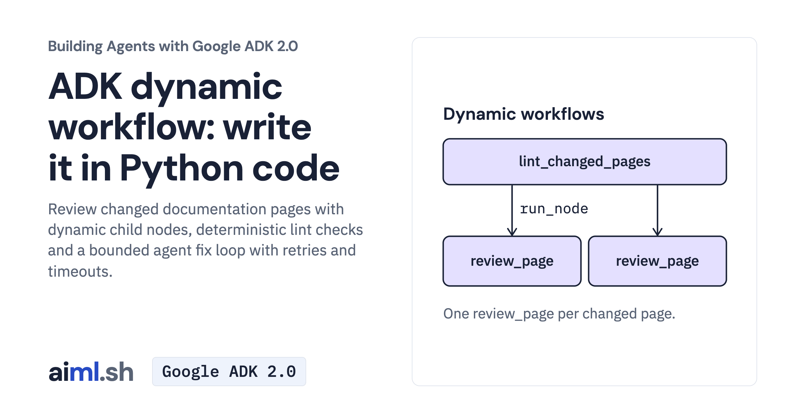

 [Building Agents with Google ADK 2.0](../) · lesson 10 of 17

# Build dynamic workflows in Python

[](https://aiml.sh/courses/google-adk/write-dynamic-workflows-in-python-code/)

Review changed documentation pages with dynamic child nodes, deterministic lint checks and a bounded agent fix loop with retries and timeouts.

- **Full lesson:** [https://aiml.sh/courses/google-adk/write-dynamic-workflows-in-python-code/](https://aiml.sh/courses/google-adk/write-dynamic-workflows-in-python-code/)
- **Reading time:** 25 min
- **Uses:** google-adk 2.12.0 with google-genai 2.32.0

## Lab

The [`lab/`](lab/) folder holds the complete runnable code, tests and recorded outputs, the same files as the lesson's download on aiml.sh. The lesson explains each step.

### Lab notes

#### Build dynamic workflows in Python

Use Python 3.12 or later. Keep the files together and run commands from `adk-dynamic-workflow-lesson/`.

##### Set up

```bash
python3 -m venv .venv
source .venv/bin/activate
python -m pip install -r requirements.txt
```

On Windows PowerShell, activate with `.venv\Scripts\Activate.ps1`.

Export `GOOGLE_API_KEY` privately in this terminal. `.env.example` is an export
reference; the Python client does not load it. Then select the Gemini API:

```bash
unset GOOGLE_GENAI_USE_VERTEXAI DOCS_MODEL
export GOOGLE_GENAI_USE_ENTERPRISE=0
```

##### Run the activity

```bash
python lint_client.py quickstart.md install.md cli.md
```

Inspect each child's `found`, `rounds`, `left` and proposed `content`. The workflow
checks a title, HTTP links and heading-level jumps; it does not check factual
correctness. It never rewrites the bundled pages. Use `python lint_client.py install.md`
for a single page. Retries, fix rounds and concurrency have separate bounds.

Model-backed activity uses your provider account. The model configuration limits
each response to 1,024 output tokens.

##### Check offline

```bash
python -m unittest -v test_lint_changed.py test_client.py
```

These checks exercise the actual code with saved replies or explicit fakes. They
make no provider requests. Saved replies illustrate the mechanism; use new cases
and inspect actual answers to evaluate a changed prompt.
