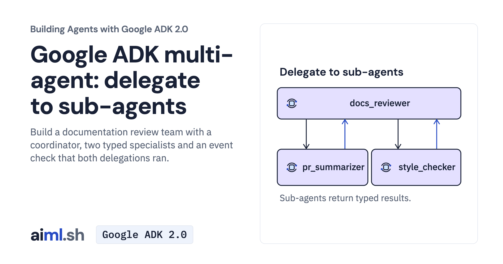

 [Building Agents with Google ADK 2.0](../) · lesson 11 of 17

# Delegate to sub-agents through a coordinator

[](https://aiml.sh/courses/google-adk/delegate-to-sub-agents-in-a-collaborative-workflow/)

Build a documentation review team with a coordinator, two typed specialists and an event check that both delegations ran.

- **Full lesson:** [https://aiml.sh/courses/google-adk/delegate-to-sub-agents-in-a-collaborative-workflow/](https://aiml.sh/courses/google-adk/delegate-to-sub-agents-in-a-collaborative-workflow/)
- **Reading time:** 20 min
- **Uses:** google-adk, google-genai

## Lab

The [`lab/`](lab/) folder holds the complete runnable code, tests and recorded outputs, the same files as the lesson's download on aiml.sh. The lesson explains each step.

### Lab notes

#### Delegate to sub-agents in a collaborative workflow

Use Python 3.12 or later. Keep the files together and run commands from `adk-sub-agents-lesson/`.

##### Set up

```bash
python3 -m venv .venv
source .venv/bin/activate
python -m pip install -r requirements.txt
```

On Windows PowerShell, activate with `.venv\Scripts\Activate.ps1`.

Export `GOOGLE_API_KEY` privately in this terminal. `.env.example` is an export
reference; the Python client does not load it. Then select the Gemini API:

```bash
unset GOOGLE_GENAI_USE_VERTEXAI DOCS_MODEL
export GOOGLE_GENAI_USE_ENTERPRISE=0
```

##### Run the activity

```bash
python review_client.py
```

Inspect `delegations`, the specialist function results and the final review.
Both `pr_summarizer` and `style_checker` should run; the latter should call
`find_long_sentences`. Use `python review_client.py --diff my-docs.diff` for
a separate diff. The client does not edit files or post a review.

Model-backed activity uses your provider account. The model configuration limits
each response to 1,024 output tokens.

##### Check offline

```bash
python -m unittest -v test_review_team.py test_client.py
```

These checks exercise the actual code with saved replies or explicit fakes. They
make no provider requests. Saved replies illustrate the mechanism; use new cases
and inspect actual answers to evaluate a changed prompt.
