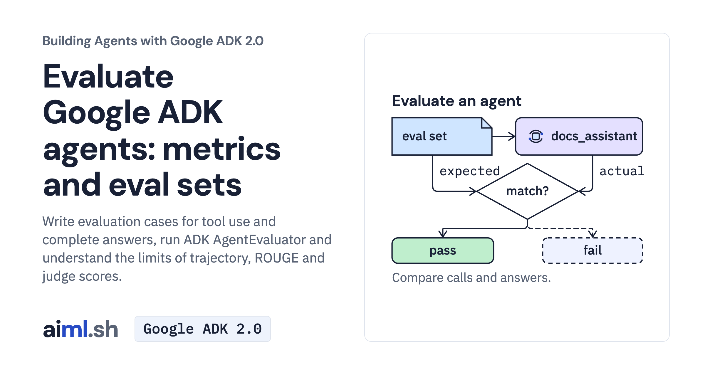

 [Building Agents with Google ADK 2.0](../) · lesson 12 of 17

# Evaluate an agent's tool trajectory and response

[](https://aiml.sh/courses/google-adk/evaluate-an-agents-tool-trajectory-and-response/)

Write evaluation cases for tool use and complete answers, run ADK AgentEvaluator and understand the limits of trajectory, ROUGE and judge scores.

- **Full lesson:** [https://aiml.sh/courses/google-adk/evaluate-an-agents-tool-trajectory-and-response/](https://aiml.sh/courses/google-adk/evaluate-an-agents-tool-trajectory-and-response/)
- **Reading time:** 25 min
- **Uses:** google-adk[eval] 2.12.0 for the live evaluation; google-adk 2.12.0 with rouge-score 0.1.2 for the offline tests

## Lab

The [`lab/`](lab/) folder holds the complete runnable code, tests and recorded outputs, the same files as the lesson's download on aiml.sh. The lesson explains each step.

### Lab notes

#### Evaluate an agent's tool trajectory and response

Use Python 3.12 or later. Keep the files together and run commands from `adk-agent-eval-lesson/`.

##### Set up

```bash
python3 -m venv .venv
source .venv/bin/activate
python -m pip install -r requirements.txt
```

On Windows PowerShell, activate with `.venv\Scripts\Activate.ps1`.

Export `GOOGLE_API_KEY` privately in this terminal. `.env.example` is an export
reference; the Python client does not load it. Then select the Gemini API:

```bash
unset GOOGLE_GENAI_USE_VERTEXAI DOCS_MODEL
export GOOGLE_GENAI_USE_ENTERPRISE=0
```

##### Run the activity

```bash
adk eval docs_agent docs_agent.test.json --config_file_path test_config.json --log_level error
```

Inspect the case statuses and metric scores. The native CLI runs each case once
here and may exit zero even when a metric fails. For two runs per case and a
nonzero exit on failed thresholds, use `python run_eval.py rouge --evaluate` in
a separate copy. That command can replace `rouge-result.json`. Judge mode,
`python run_eval.py judge --evaluate`, generates new answers and adds model
judgments; it does not re-score old answers in place.

Model-backed activity uses your provider account. The model configuration limits
each response to 1,024 output tokens.

##### Check offline

```bash
python -m unittest -v test_eval_results.py test_client.py
```

These checks exercise the actual code with saved replies or explicit fakes. They
make no provider requests. Saved replies illustrate the mechanism; use new cases
and inspect actual answers to evaluate a changed prompt.
