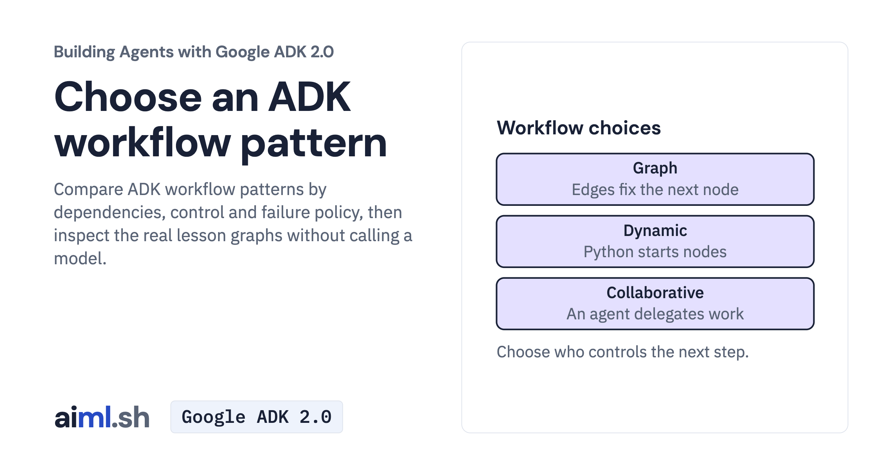

 [Building Agents with Google ADK 2.0](../) · lesson 13 of 17

# Choose an ADK workflow pattern

[](https://aiml.sh/courses/google-adk/choose-an-adk-workflow-pattern/)

Compare ADK workflow patterns by dependencies, control and failure policy, then inspect the real lesson graphs without calling a model.

- **Full lesson:** [https://aiml.sh/courses/google-adk/choose-an-adk-workflow-pattern/](https://aiml.sh/courses/google-adk/choose-an-adk-workflow-pattern/)
- **Reading time:** 15 min
- **Uses:** google-adk, google-genai

## Lab

The [`lab/`](lab/) folder holds the complete runnable code, tests and recorded outputs, the same files as the lesson's download on aiml.sh. The lesson explains each step.

### Lab notes

#### Inspect ADK workflow patterns

This inspector constructs the actual course graphs and agent trees without sending a user turn. It needs Python 3.12+, the pinned dependencies and the bundled `patterns/` folder. Extract the complete lesson ZIP and open a terminal in `adk-workflow-patterns/`.

```sh
python3 -m venv .venv
source .venv/bin/activate
python -m pip install -r requirements-lock.txt
python -W ignore pattern_map.py
```

The command prints graph edges or agent trees and writes `pattern-map.json`. Look for the refinement back-edge, the parallel join and the nested AgentTool tree. No API key or model request is needed. This is an inspection script; use a pattern's own lesson to run its application.

The bundled builders use the current docuctl name. `pattern-map.json` is the original structure record; it records node names and edges, not newly executed model replies.

##### Offline checks

```sh
python -W ignore -m unittest -v test_pattern_map.py
```

The tests compare the saved map with structures built from the bundled lesson modules and exercise unreachable-node and deprecated-template warnings. They check construction, not generated answers.
