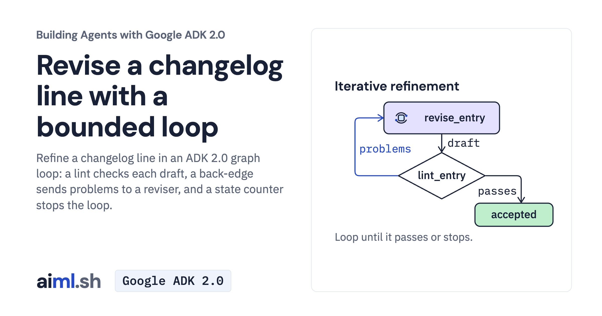

 [Building Agents with Google ADK 2.0](../) · lesson 15 of 17

# Revise a changelog line with a bounded loop

[](https://aiml.sh/courses/google-adk/iterative-refinement/)

Refine a changelog line in an ADK 2.0 graph loop: a lint checks each draft, a back-edge sends problems to a reviser, and a state counter stops the loop.

- **Full lesson:** [https://aiml.sh/courses/google-adk/iterative-refinement/](https://aiml.sh/courses/google-adk/iterative-refinement/)
- **Reading time:** 20 min
- **Uses:** google-adk 2.12.0 with google-genai 2.32.0

## Lab

The [`lab/`](lab/) folder holds the complete runnable code, tests and recorded outputs, the same files as the lesson's download on aiml.sh. The lesson explains each step.

### Lab notes

#### Iterative refinement

This flat project contains the workflow, input fixtures, saved model replies and offline tests. Use Python 3.12+.

##### Set up

```sh
python3 -m venv .venv
source .venv/bin/activate
python -m pip install -r requirements.txt
```

##### Compare the cases

```sh
python run.py
```

The default runs the real ADK workflow with saved model replies. It makes no model request and does not overwrite the fixtures. Inspect each case's routes, final message or expected error. It checks behavior for the saved replies, not general answer quality.

To request new Gemini replies instead, copy `.env.example` to `.env`, set your API key and run `python run.py --live`. Existing shell variables take precedence. Clear alternate backend settings from previous activities if necessary. Model wording and outcomes can differ. The agents use LOW thinking and a 2,048-token output cap per request; truncation can leave structured output incomplete.

##### Offline checks

```sh
python -W ignore -m unittest -v test_refine_entry.py test_runner.py
```

The suite replays fixtures and uses controlled models to check the pattern's failure boundaries. `test_runner.py` exercises the comparison entry point through the actual workflows.
