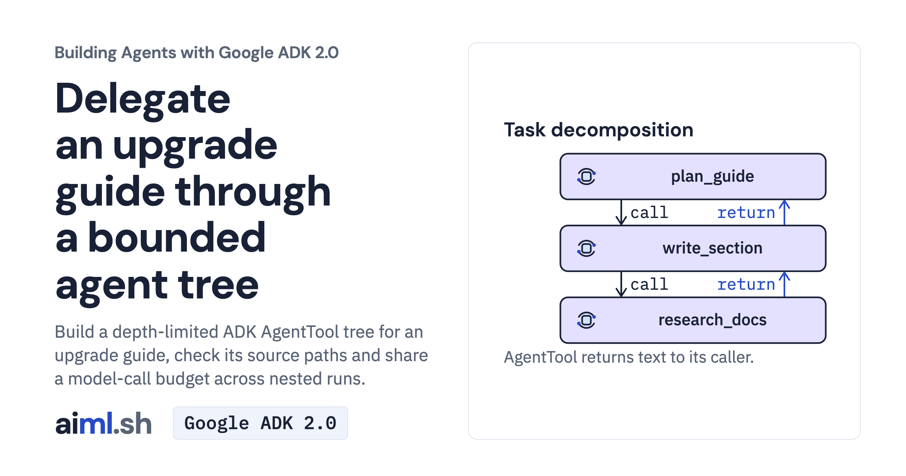

 [Building Agents with Google ADK 2.0](../) · lesson 17 of 17

# Delegate an upgrade guide through a bounded agent tree

[](https://aiml.sh/courses/google-adk/hierarchical-task-decomposition/)

Build a depth-limited ADK AgentTool tree for an upgrade guide, check its source paths and share a model-call budget across nested runs.

- **Full lesson:** [https://aiml.sh/courses/google-adk/hierarchical-task-decomposition/](https://aiml.sh/courses/google-adk/hierarchical-task-decomposition/)
- **Reading time:** 25 min
- **Uses:** google-adk 2.12.0 with google-genai 2.32.0

## Lab

The [`lab/`](lab/) folder holds the complete runnable code, tests and recorded outputs, the same files as the lesson's download on aiml.sh. The lesson explains each step.

### Lab notes

#### Hierarchical task decomposition

This flat project contains the workflow, input fixtures, saved model replies and offline tests. Use Python 3.12+.

##### Set up

```sh
python3 -m venv .venv
source .venv/bin/activate
python -m pip install -r requirements.txt
```

##### Compare the cases

```sh
python run.py
```

The default replays the current `upgrade_guide.py` against its fresh docuctl recording and checks the exact request hash. The depth-two writer uses its actual search/read tools. It makes no model request and does not overwrite the fixtures. Inspect each case's routes, final message or expected error. It checks behavior for the saved replies, not general answer quality.

To request new Gemini replies instead, copy `.env.example` to `.env`, set your API key and run `python run.py --live`. Existing shell variables take precedence. Clear alternate backend settings from previous activities if necessary. Model wording and outcomes can differ. The agents use LOW thinking and a 1,024-token output cap per request; truncation can leave structured output incomplete.

##### Offline checks

```sh
python -W ignore -m unittest -v test_upgrade_guide.py test_runner.py
```

The suite replays fixtures and uses controlled models to check the pattern's failure boundaries. Saved replies test the current docuctl orchestration. `test_runner.py` exercises the comparison entry point through the actual workflows.
