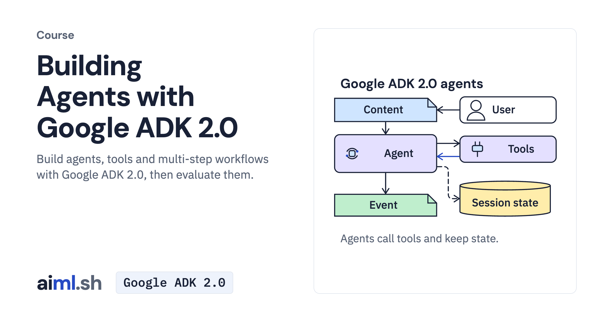

#  Building Agents with Google ADK 2.0

Build agents, tools and multi-step workflows with Google ADK 2.0, then evaluate them.

- **Course on aiml.sh:** [https://aiml.sh/courses/google-adk/building-agents/](https://aiml.sh/courses/google-adk/building-agents/)
- **Lessons:** 17 · **Reading time:** about 6 hours
- **Prerequisites:** Python and HTTP APIs.
- **Framework:** Google ADK 2.0

## What you'll learn

- Define an ADK agent with function tools, run it from Python with a Runner and session service, and read its event stream.
- Connect an agent to MCP servers with McpToolset, validate typed function arguments and require confirmation for writes.
- Persist sessions in SQLite and search conversation memory while the process runs; guard model and tool calls with callbacks and plugins.
- Build graph workflows with conditional edges, pause one for human approval with RequestInput and delegate to sub-agents.
- Score an agent's tool trajectory and final response with AgentEvaluator before you change it.

## Lessons

| # | Lesson | Time | Code | Full lesson |
|---|---|---|---|---|
| 1 | [Build your first ADK agent with Gemini](01-build-an-llm-agent/) | 15&nbsp;min | [lab](01-build-an-llm-agent/lab/) | [read](https://aiml.sh/courses/google-adk/build-an-llm-agent/) |
| 2 | [Run an agent and read its event stream](02-run-an-agent-from-python-and-read-its-event-stream/) | 20&nbsp;min | [lab](02-run-an-agent-from-python-and-read-its-event-stream/lab/) | [read](https://aiml.sh/courses/google-adk/run-an-agent-from-python-and-read-its-event-stream/) |
| 3 | [Give an agent typed function tools](03-add-typed-function-tools/) | 25&nbsp;min | [lab](03-add-typed-function-tools/lab/) | [read](https://aiml.sh/courses/google-adk/add-typed-function-tools/) |
| 4 | [Connect an agent to MCP servers with McpToolset](04-connect-an-agent-to-mcp-servers-with-mcptoolset/) | 20&nbsp;min | [lab](04-connect-an-agent-to-mcp-servers-with-mcptoolset/lab/) | [read](https://aiml.sh/courses/google-adk/connect-an-agent-to-mcp-servers-with-mcptoolset/) |
| 5 | [Persist sessions and search conversation memory](05-persist-session-state-and-long-term-memory/) | 25&nbsp;min | [lab](05-persist-session-state-and-long-term-memory/lab/) | [read](https://aiml.sh/courses/google-adk/persist-session-state-and-long-term-memory/) |
| 6 | [Guard model and tool calls with callbacks and plugins](06-guard-model-and-tool-calls-with-callbacks-and-plugins/) | 25&nbsp;min | [lab](06-guard-model-and-tool-calls-with-callbacks-and-plugins/lab/) | [read](https://aiml.sh/courses/google-adk/guard-model-and-tool-calls-with-callbacks-and-plugins/) |
| 7 | [Build a graph workflow from nodes and edges](07-build-a-graph-workflow-from-nodes-and-edges/) | 20&nbsp;min | [lab](07-build-a-graph-workflow-from-nodes-and-edges/lab/) | [read](https://aiml.sh/courses/google-adk/build-a-graph-workflow-from-nodes-and-edges/) |
| 8 | [Route a workflow with conditional edges](08-route-a-workflow-with-conditional-edges/) | 20&nbsp;min | [lab](08-route-a-workflow-with-conditional-edges/lab/) | [read](https://aiml.sh/courses/google-adk/route-a-workflow-with-conditional-edges/) |
| 9 | [Pause a workflow for human approval](09-pause-a-workflow-for-human-approval/) | 25&nbsp;min | [lab](09-pause-a-workflow-for-human-approval/lab/) | [read](https://aiml.sh/courses/google-adk/pause-a-workflow-for-human-approval/) |
| 10 | [Build dynamic workflows in Python](10-write-dynamic-workflows-in-python-code/) | 25&nbsp;min | [lab](10-write-dynamic-workflows-in-python-code/lab/) | [read](https://aiml.sh/courses/google-adk/write-dynamic-workflows-in-python-code/) |
| 11 | [Delegate to sub-agents through a coordinator](11-delegate-to-sub-agents-in-a-collaborative-workflow/) | 20&nbsp;min | [lab](11-delegate-to-sub-agents-in-a-collaborative-workflow/lab/) | [read](https://aiml.sh/courses/google-adk/delegate-to-sub-agents-in-a-collaborative-workflow/) |
| 12 | [Evaluate an agent's tool trajectory and response](12-evaluate-an-agents-tool-trajectory-and-response/) | 25&nbsp;min | [lab](12-evaluate-an-agents-tool-trajectory-and-response/lab/) | [read](https://aiml.sh/courses/google-adk/evaluate-an-agents-tool-trajectory-and-response/) |
| 13 | [Choose an ADK workflow pattern](13-choose-an-adk-workflow-pattern/) | 15&nbsp;min | [lab](13-choose-an-adk-workflow-pattern/lab/) | [read](https://aiml.sh/courses/google-adk/choose-an-adk-workflow-pattern/) |
| 14 | [Generate and review a release announcement](14-generate-and-review/) | 20&nbsp;min | [lab](14-generate-and-review/lab/) | [read](https://aiml.sh/courses/google-adk/generate-and-review/) |
| 15 | [Revise a changelog line with a bounded loop](15-iterative-refinement/) | 20&nbsp;min | [lab](15-iterative-refinement/lab/) | [read](https://aiml.sh/courses/google-adk/iterative-refinement/) |
| 16 | [Run independent workflow branches and gather results](16-parallel-fan-out-and-gather/) | 25&nbsp;min | [lab](16-parallel-fan-out-and-gather/lab/) | [read](https://aiml.sh/courses/google-adk/parallel-fan-out-and-gather/) |
| 17 | [Delegate an upgrade guide through a bounded agent tree](17-hierarchical-task-decomposition/) | 25&nbsp;min | [lab](17-hierarchical-task-decomposition/lab/) | [read](https://aiml.sh/courses/google-adk/hierarchical-task-decomposition/) |

Each lesson folder has a short summary, its diagram and its lab. The complete lesson, with explanations, recorded results and checks, is on aiml.sh.

[Back to all courses](../../README.md#courses)
