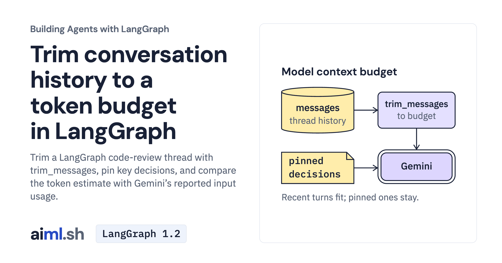

 [Building Agents with LangGraph](../) · lesson 3 of 9

# Trim conversation history to a token budget in LangGraph

[](https://aiml.sh/courses/langgraph/trim-history-to-a-token-budget/)

Trim a LangGraph code-review thread with trim_messages, pin key decisions, and compare the token estimate with Gemini’s reported input usage.

- **Full lesson:** [https://aiml.sh/courses/langgraph/trim-history-to-a-token-budget/](https://aiml.sh/courses/langgraph/trim-history-to-a-token-budget/)
- **Reading time:** 25 min
- **Uses:** langgraph 1.2.16, langchain-core 1.6.12, langchain-google-genai 4.4.2; langchain-ollama 1.1.0 for the local alternative; pytest 9.1.1 for the offline tests

## Lab

The [`lab/`](lab/) folder holds the complete runnable code, tests and recorded outputs, the same files as the lesson's download on aiml.sh. The lesson explains each step.

### Lab notes

#### Context budget

The in-memory checkpointer retains the complete thread while the model receives a trimmed view. Pinned decisions stay in the system message. Character-based token estimates are approximate and can undercount provider input.

##### Setup

Run from a working copy of this lesson folder:

```bash
python3.12 -m venv .venv
source .venv/bin/activate
python -m pip install -r requirements-lock.txt
```

Live execution uses `GOOGLE_API_KEY` and defaults to Gemini `gemini-3.8-flash`. Scripts do not load `.env` automatically. Fresh provider requests can incur charges. The optional Ollama path uses an existing service and already installed model selected with `REVIEW_MODEL`; compatible APIs do not imply equal answers.

##### Execute

```bash
python record.py
```

This command makes fresh model requests. `record.py` runs the supplied scenarios and overwrites `runs.json`; use a disposable copy when recording. Existing `runs.json` and `run-output.txt` preserve historical supplied model observations. They do not measure a new run. The tools and conversation inputs are local fixtures, not an external review service.

##### Check without a model

```bash
python -m pytest -q test_graph.py test_live_probe.py
```

Tests execute the actual SDK graph with scripted model replies and inspect supplied recordings. They require no model server or API key and do not prove fresh model inference. Run tests from this folder to avoid importing another lesson's `graph.py`.

##### Genuine plain-versus-pinned observation, October 23, 2026

The [run manifest](lab/runs/20261023-genuine-gemini/manifest.json), [actual process stdout](lab/runs/20261023-genuine-gemini/stdout.txt) and [structured events](lab/runs/20261023-genuine-gemini/events.json) preserve two independent five-turn native LangGraph threads on Gemini `gemini-3.8-flash`. All ten AI replies came from the provider; no scripted reply seeded either thread. Both threads retained ten messages. The plain thread's final model view had lost the reviewer/deadline decision and its answer reported the information unavailable. The pinned thread retained the decision in its system message and correctly answered that mlee reviews #412 and it must merge before the 2.5 freeze on November 14.

The [per-turn accounting](lab/runs/20261023-genuine-gemini/accounting.json) preserves the approximate estimate, preflight count and reported provider usage separately. On the two log turns, estimates of 271/295 corresponded to 433/464 provider input tokens, above the 400-token approximate budget. On turn 2, preflight counts 145/171 differed from provider input 326/330. The count endpoint is not a general billing cap. All observed provider input counts stayed at or below 464, and candidate-plus-thinking output at or below 218, within the reviewed 4096 limits.

The provider reported 2485 input tokens, 345 candidate tokens and 641 thinking tokens, 3471 total, across 10 generation and 10 token-count requests. These records are not an invoice. The log's 15 passing entries and 14-second timestamp span are supplied fixture contents; no CI tests or performance benchmark ran. This is one conversation comparison, not a general model accuracy or memory result.

[Desktop](lab/runs/20261023-genuine-gemini/images/completed-end-1440@2x.png), [390px](lab/runs/20261023-genuine-gemini/images/completed-end-390@2x.png) and [320px](lab/runs/20261023-genuine-gemini/images/completed-end-320@2x.png) originals show completed scrollback from one Python PTY process. The [independent outcome review](lab/runs/20261023-genuine-gemini/outcome-review.json) checked full views for paraphrase leakage and read the actual answers, rather than accepting literal string checks as semantic proof.

`live_probe.py` is the exact probe used for this run. It requires an external in-process approval guard before SDK construction or credential access. The private operator is not bundled. Running `python live_probe.py` directly refuses without spending; do not bypass its handshake. The normal `record.py` experiment requires its own spending authorization and does not enforce the private operator's limits.

The offline command above runs 9 graph tests and 12 probe tests, 21 total, using fixed replies. These tests check native trimming/state behavior, refusals and honest completion labels; they make no fresh inference. Historical `runs.json` and its tests remain unchanged.
