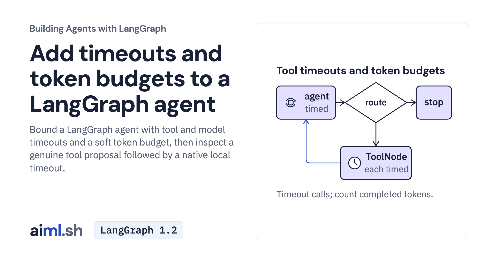

 [Building Agents with LangGraph](../) · lesson 4 of 9

# Add timeouts and token budgets to a LangGraph agent

[](https://aiml.sh/courses/langgraph/add-timeouts-and-token-budgets/)

Bound a LangGraph agent with tool and model timeouts and a soft token budget, then inspect a genuine tool proposal followed by a native local timeout.

- **Full lesson:** [https://aiml.sh/courses/langgraph/add-timeouts-and-token-budgets/](https://aiml.sh/courses/langgraph/add-timeouts-and-token-budgets/)
- **Reading time:** 22 min
- **Uses:** langgraph 1.2.16, langchain-core 1.6.12, langchain-google-genai 4.4.2; langchain-ollama 1.1.0 for the local alternative; pytest 9.1.1 for the offline tests

## Lab

The [`lab/`](lab/) folder holds the complete runnable code, tests and recorded outputs, the same files as the lesson's download on aiml.sh. The lesson explains each step.

### Lab notes

#### Bound the code-review graph's calls

The async SDK graph has per-tool timeouts, a model-node timeout and a soft
between-call budget. `ci.py` is a local CI stub with fixed job records and delays.

##### Setup

Use a new working copy of this lab and run these commands from that folder:

```bash
python3.12 -m venv .venv
source .venv/bin/activate
python -m pip install -r requirements-lock.txt
```

For Gemini, export your own key as `GOOGLE_API_KEY`. The scripts do not load
`.env` automatically. The default `REVIEW_MODEL` is `gemini-3.8-flash`. Keep
alternate cloud-backend settings out of this shell when using a Developer API key.
Fresh provider interactions can incur charges.

For the local alternative, start an existing Ollama service with an already
installed `gemma4:e2b` and set `REVIEW_MODEL=gemma4:e2b`. These commands do not
install model weights. A compatible API does not guarantee the same model answer.

##### Ask one positive question

```bash
python graph.py "Why is CI failing on pull request 415?"
```

This makes fresh model requests and prints the outcome, reported token subtotal
and answer. Tool data comes from the supplied CI stub, not a real CI service.
A timed-out call does not guarantee the remote provider stopped processing it.

##### Record the comparisons

```bash
python record.py
```

The batch runs a positive case, a slow tool, two token thresholds and a short model
timeout, then overwrites `runs.json`. Use a disposable copy for a new recording.
The supplied saved output remains the original observation, not a new
measurement of the changed missing-usage policy.

##### Missing usage

The graph adds only valid nonnegative integer `total_tokens` values. Missing or
malformed metadata marks `usage_known=false`, keeps earlier reported tokens as
a known subtotal, and stops with `missing_usage` before another tool or model
call. An answer without usage follows this rule too. A reported integer zero is
different from missing usage. No unreported usage or separate reasoning count
is invented. The subtotal cannot bound the cost of the unreported request.

For replies with valid usage, the existing soft-budget behavior is unchanged:
one completed call can overshoot the threshold. Neither that threshold nor the
node timeout guarantees exact provider billing. A model timeout or error also marks
the run total unknown, retaining only earlier reported tokens as a known subtotal.

##### Offline checks

```bash
python -m pytest -v test_graph.py test_live_probe.py test_run_evidence.py
```

The real SDK graph receives fake replies and fixed usage fields. Tests cover the
existing limits and missing, empty, malformed and explicitly zero usage. They
do not verify a fresh provider answer or current provider latency.

##### Genuine model proposal and native timeout, October 23, 2026

The saved [manifest](lab/runs/20261023-genuine-gemini/manifest.json), [events](lab/runs/20261023-genuine-gemini/events.json) and [original stdout](lab/runs/20261023-genuine-gemini/stdout.txt) record one Gemini generation request and one token-count request. The model proposed `fetch_job_log(job_id=815)`. Native `ToolNode` returned the matching error message after the three-second timeout against the eight-second local fixture. The graph followed `agent → tools` and paused at `interrupt_after=['tools']`. It made no follow-up model request or model-written answer about the timeout.

The provider reported 224 input, 20 candidate and 159 thinking tokens: 403 total. The preflight count was also 224 for this one request; a token-count preflight is not a general billable-input cap. The arithmetic estimate is $0.00083925 at $0.75 per million input tokens and $3.75 per million output tokens including thinking. Usage and estimates are not invoices. See [accounting](lab/runs/20261023-genuine-gemini/accounting.json), [independent outcome review](lab/runs/20261023-genuine-gemini/outcome-review.json) and [provenance](lab/runs/20261023-genuine-gemini/provenance.json).

The original [desktop](lab/runs/20261023-genuine-gemini/images/completed-end-1440@2x.png), [390px](lab/runs/20261023-genuine-gemini/images/completed-end-390@2x.png) and [320px](lab/runs/20261023-genuine-gemini/images/completed-end-320@2x.png) captures show the same completed Python PTY process. They are unchanged original frames, not three runs or reconstructed result cards.

`live_probe.py` is the exact executed probe. Direct execution refuses before SDK construction or credential access unless a separate external async guard authorizes the process. The private operator is not bundled here. It required explicit low thinking, requested at most 4096 output tokens including thinking, allowed one count and one generation request, and used a 45-second HTTP timeout with no retries. The graph model-node timeout was 60 seconds. The probe's `token_budget=1_000_000` isolates the tool timer and is not a spending bound. The ordinary `graph.py` factory uses `max_retries=1`; it does not enforce the probe operator's spending policy.

This observation does not demonstrate a genuine model-node timeout, a model-budget stop, a live CI lookup or a follow-up answer. If the model does not propose the slow tool, the probe records an incomplete target and does not automatically rerun. Offline probe tests use scripted replies to exercise that boundary and the native static breakpoint. Saved-record checks compare call IDs, source hashes and original image hashes without provider requests.

##### Earlier incomplete preflight

The separate [failure manifest](lab/runs/20261023-incomplete-preflight/manifest.json), [events](lab/runs/20261023-incomplete-preflight/events.json) and [original stdout](lab/runs/20261023-incomplete-preflight/stdout.txt) preserve an earlier attempt. It dispatched one token-count request, then stopped with `DecodingError` before any generation or tool execution. Its local `model_calls=1` means an attempted graph invocation, not inference. Its unknown-usage subtotal of zero is not a provider usage report.

An offline compressed-response check reproduced double decoding in the external operator's response reconstruction. The failed attempt did not retain its encoding header, so the exact header remains unverified. The successful observation used a separate reviewed repair and authorization; it was not an automatic retry. All original failed records remain unchanged. The historical five-scenario `runs.json`, `run-output.txt` and `test-output.txt` remain supplied historical observations, separate from the current source and tests.
