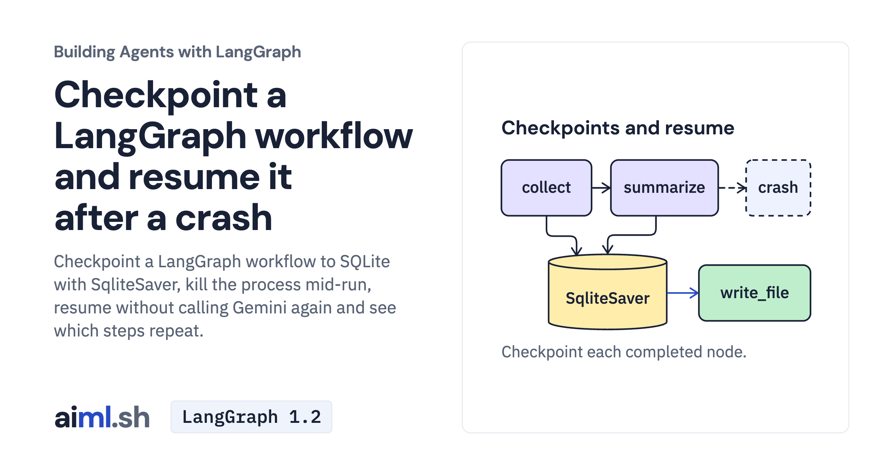

 [Building Agents with LangGraph](../) · lesson 5 of 9

# Checkpoint a LangGraph workflow and resume it after a crash

[](https://aiml.sh/courses/langgraph/checkpoint-and-resume-a-workflow/)

Checkpoint a LangGraph workflow to SQLite with SqliteSaver, kill the process mid-run, resume without calling Gemini again and see which steps repeat.

- **Full lesson:** [https://aiml.sh/courses/langgraph/checkpoint-and-resume-a-workflow/](https://aiml.sh/courses/langgraph/checkpoint-and-resume-a-workflow/)
- **Reading time:** 22 min
- **Uses:** langgraph 1.2.16, langgraph-checkpoint-sqlite 3.1.2, langchain-core 1.6.12, langchain-google-genai 4.4.2; langchain-ollama 1.1.0 for the local alternative; pytest 9.1.1 for the offline tests

## Lab

The [`lab/`](lab/) folder holds the complete runnable code, tests and recorded outputs, the same files as the lesson's download on aiml.sh. The lesson explains each step.

### Lab notes

#### Checkpoint and resume the release-notes workflow

The graph reads supplied pull requests, asks the selected model for release notes,
writes Markdown and appends a local announcement log. The log is not an external
chat post. SQLite stores the graph checkpoints.

##### Setup

Use a new working copy of this lab and run these commands from that folder:

```bash
python3.12 -m venv .venv
source .venv/bin/activate
python -m pip install -r requirements-lock.txt
```

For Gemini, export your own key as `GOOGLE_API_KEY`. The scripts do not load
`.env` automatically. The default `REVIEW_MODEL` is `gemini-3.8-flash`. Keep
alternate cloud-backend settings out of this shell when using a Developer API key.
Fresh provider interactions can incur charges.

The Gemini client caps each response with `max_output_tokens=1024`, disables SDK
retries with `max_retries=0`, and sets a 30-second request timeout. These settings
do not cap the bill or prove that the notes are complete. The workflow saves the
returned text; it does not reject a reply that stopped at its output limit. Read
the resulting notes before using them. A failed model request leaves `summarize`
unfinished, so resuming that failure can make another request. The one-request
crash/resume example below assumes the summarize step finished and was saved.

The included historical recordings precede these explicit transport limits. The
offline tests inspect the current serialized SDK request and a controlled 429;
those mocked responses are not a new provider recording.

For the local alternative, start an existing Ollama service with an already
installed `gemma4:e2b` and set `REVIEW_MODEL=gemma4:e2b`. These commands do not
install model weights. A compatible API does not guarantee the same model answer.

##### Run one positive workflow

```bash
python workflow.py --work-dir runs/release-2-5 --thread release-2-5 --version 2.5.0
```

The selected directory holds `checkpoints.db` and `out/`. Inspect
`runs/release-2-5/out/2.5.0.md` and `out/announcements.log`. A completed thread
started again with input runs the workflow again; use a new directory/thread for
a new experiment. This command makes a fresh provider interaction.

##### Stop after the model step, then resume

Use a different new directory for this experiment:

```bash
CRASH_AT="after summarize" python workflow.py --work-dir runs/crash-2-5 --thread crash-2-5 --version 2.5.0
python workflow.py --work-dir runs/crash-2-5 --thread crash-2-5 --version 2.5.0
```

The first command intentionally exits with code 1. Run the second command
afterwards: the same directory and thread load the pending checkpoint. The
completed summarize step is retained; the normal resume goes to `write_file`.
Do not set `CRASH_AT` for the second command. A crash inside a node after a side
effect can repeat that effect; this workflow has no announcement idempotency key.

##### Reset and record all diagnostic cases

```bash
python record.py --reset-example-data
```

This batch explicitly deletes the lab's own `out/` and `checkpoints.db` before
launching its crash scenarios. Without the flag it exits before deleting files or
starting a process. Run it only in a disposable copy; it overwrites `runs.json`.
It does not reset a separate directory selected with `workflow.py --work-dir`.

##### Offline checks

```bash
python -m pytest -v test_workflow.py test_record.py test_saved_actual.py
```

The tests use fake model replies and temporary SQLite/output directories.
Existing resume checks retain completed work and demonstrate repeated side
effects. New checks preserve existing data without explicit reset and verify the
CLI's selected work directory. They do not execute a fresh provider request.

##### Actual one-request crash/resume record

`runs/20261023T132807Z-native-crash-resume/` retains one actual native workflow
execution: one Gemini HTTP 200/STOP, intentional start exit 1 after summarize,
then same-thread/work-directory resume exit 0 with no key and no new dispatch.
The saved notes were unchanged; one Markdown file and one local announcement
line were written. Source, model, 1024-output-token cap and no-retry settings were unchanged.

The generated phrase “to streamline export functionality” is not supported by
the terse PR fixture. Keep the original model text when reviewing this recording.
It demonstrates checkpoint continuation, not comprehensive factual release-note
quality. Compare the notes to the supplied source before using them.

All nine unedited 2x PNG files are post-completion scroll viewports of ONE transcript.
start/middle/end are scroll positions, not temporal execution stages or nine runs;
the three desktop files are naturally byte-identical. Full unchanged PTY and
individual process stdout, states, Markdown and announcement are included.
provider-projection.json removes only opaque thoughtSignature/thought_signature
fields from parsed saved provider JSON, retaining original private hashes. No
provider keys, approvals, private server logs or operator scripts are included.
Missing token fields are unknown, not zero; the invoice was not verified.
