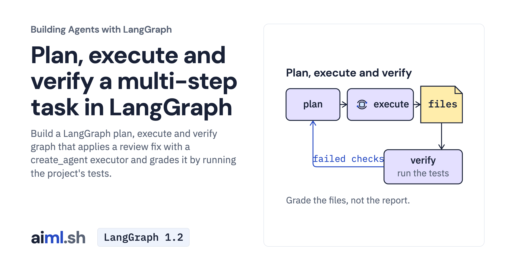

 [Building Agents with LangGraph](../) · lesson 7 of 9

# Plan, execute and verify a multi-step task in LangGraph

[](https://aiml.sh/courses/langgraph/plan-execute-and-verify-a-task/)

Build a LangGraph plan, execute and verify graph that applies a review fix with a create_agent executor and grades it by running the project's tests.

- **Full lesson:** [https://aiml.sh/courses/langgraph/plan-execute-and-verify-a-task/](https://aiml.sh/courses/langgraph/plan-execute-and-verify-a-task/)
- **Reading time:** 25 min
- **Uses:** langgraph 1.2.16, langchain 1.4.6, langchain-core 1.6.12, langchain-google-genai 4.4.2, pytest 9.1.1; langchain-ollama 1.1.0 for the local alternative

## Lab

The [`lab/`](lab/) folder holds the complete runnable code, tests and recorded outputs, the same files as the lesson's download on aiml.sh. The lesson explains each step.

### Lab notes

#### Plan, execute and verify a multi-step task in LangGraph

Lab for https://aiml.sh/courses/langgraph/plan-execute-and-verify-a-task/. Use Python 3.12 or later.

##### Setup

```sh
python3 -m venv .venv
source .venv/bin/activate
python -m pip install -r requirements-lock.txt
```

##### Run and test

Live model commands require `GOOGLE_API_KEY`; `REVIEW_MODEL=gemma4:e2b` selects an already available local Ollama model. The test command uses fakes and saved replies, without a model call.

```sh
python record.py
```

```sh
python -m pytest -v test_graph.py
```

`run-output.txt` and `runs.json` contain saved model runs; `test-output.txt` is a separate saved test result. A graph finishing does not establish that its answer or side effect is correct. The lesson explains the supplied failure cases and fixture limits.
