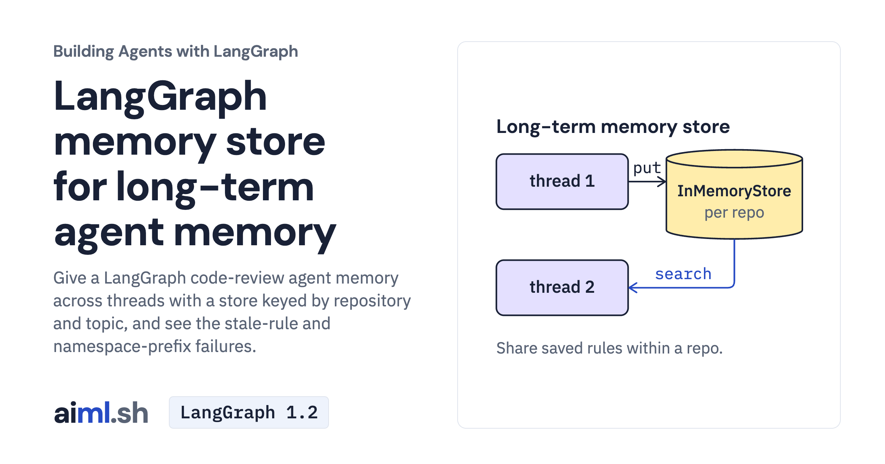

 [Building Agents with LangGraph](../) · lesson 9 of 9

# Add a long-term memory store

[](https://aiml.sh/courses/langgraph/add-a-long-term-memory-store/)

Give a LangGraph code-review agent memory across threads with a store keyed by repository and topic, and see the stale-rule and namespace-prefix failures.

- **Full lesson:** [https://aiml.sh/courses/langgraph/add-a-long-term-memory-store/](https://aiml.sh/courses/langgraph/add-a-long-term-memory-store/)
- **Reading time:** 30 min
- **Uses:** langgraph 1.2.16, langchain-core 1.6.12, langchain-google-genai 4.4.2, langchain-ollama 1.1.0; pytest 9.1.1 for the offline tests

## Lab

The [`lab/`](lab/) folder holds the complete runnable code, tests and recorded outputs, the same files as the lesson's download on aiml.sh. The lesson explains each step.

### Lab notes

#### Add a long-term memory store

Lab for https://aiml.sh/courses/langgraph/add-a-long-term-memory-store/. Use Python 3.12 or later.

##### Setup

```sh
python3 -m venv .venv
source .venv/bin/activate
python -m pip install -r requirements-lock.txt
```

##### Run and test

Live model commands require `GOOGLE_API_KEY`; `REVIEW_MODEL=gemma4:e2b` selects an already available local Ollama model. The test command uses fakes and saved replies, without a model call.

```sh
python3 -m pip install -r requirements-lock.txt
python3 record.py
```

```sh
python3 -m pytest -v test_graph.py
```

`run-output.txt` and `runs.json` contain saved model runs; `test-output.txt` is a separate saved test result. A graph finishing does not establish that its answer or side effect is correct. The lesson explains the supplied failure cases and fixture limits.
