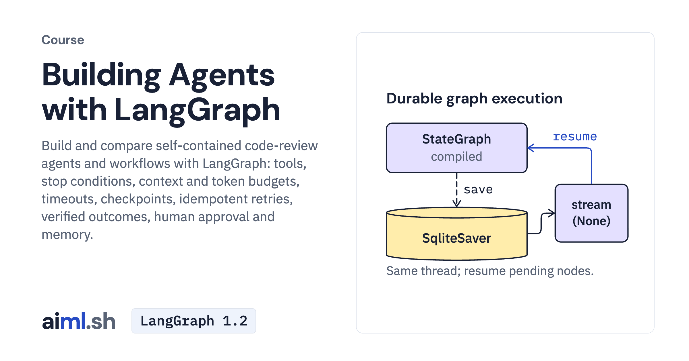

#  Building Agents with LangGraph

Build and compare self-contained code-review agents and workflows with LangGraph: tools, stop conditions, context and token budgets, timeouts, checkpoints, idempotent retries, verified outcomes, human approval and memory.

- **Course on aiml.sh:** [https://aiml.sh/courses/langgraph/](https://aiml.sh/courses/langgraph/)
- **Lessons:** 9 · **Reading time:** about 4 hours
- **Prerequisites:** Python 3.12, async Python and pytest, and a Gemini API key (or Ollama with gemma4:e2b).
- **Framework:** LangGraph 1.2

## What you'll learn

- Build a StateGraph agent with tools, route each reply with conditional edges and stop it in a named state.
- Trim conversation history to a token budget, and time out tool and model calls.
- Checkpoint a workflow to SQLite, resume it after a crash, and make retried writes idempotent.
- Verify a multi-step task from the files it changed, not from the agent's report.
- Pause a graph for human approval and share repository conventions across threads through a store.

## Lessons

| # | Lesson | Time | Code | Full lesson |
|---|---|---|---|---|
| 1 | [Build a graph agent with tools](01-build-a-graph-agent-with-tools/) | 25&nbsp;min | [lab](01-build-a-graph-agent-with-tools/lab/) | [read](https://aiml.sh/courses/langgraph/build-a-graph-agent-with-tools/) |
| 2 | [Add branches and stop conditions to a LangGraph agent](02-add-branches-and-stop-conditions/) | 20&nbsp;min | [lab](02-add-branches-and-stop-conditions/lab/) | [read](https://aiml.sh/courses/langgraph/add-branches-and-stop-conditions/) |
| 3 | [Trim conversation history to a token budget in LangGraph](03-trim-history-to-a-token-budget/) | 25&nbsp;min | [lab](03-trim-history-to-a-token-budget/lab/) | [read](https://aiml.sh/courses/langgraph/trim-history-to-a-token-budget/) |
| 4 | [Add timeouts and token budgets to a LangGraph agent](04-add-timeouts-and-token-budgets/) | 22&nbsp;min | [lab](04-add-timeouts-and-token-budgets/lab/) | [read](https://aiml.sh/courses/langgraph/add-timeouts-and-token-budgets/) |
| 5 | [Checkpoint a LangGraph workflow and resume it after a crash](05-checkpoint-and-resume-a-workflow/) | 22&nbsp;min | [lab](05-checkpoint-and-resume-a-workflow/lab/) | [read](https://aiml.sh/courses/langgraph/checkpoint-and-resume-a-workflow/) |
| 6 | [Make LangGraph retries idempotent](06-make-retries-idempotent/) | 22&nbsp;min | [lab](06-make-retries-idempotent/lab/) | [read](https://aiml.sh/courses/langgraph/make-retries-idempotent/) |
| 7 | [Plan, execute and verify a multi-step task in LangGraph](07-plan-execute-and-verify-a-task/) | 25&nbsp;min | [lab](07-plan-execute-and-verify-a-task/lab/) | [read](https://aiml.sh/courses/langgraph/plan-execute-and-verify-a-task/) |
| 8 | [Add human-in-the-loop interrupts](08-add-human-in-the-loop-interrupts/) | 30&nbsp;min | [lab](08-add-human-in-the-loop-interrupts/lab/) | [read](https://aiml.sh/courses/langgraph/add-human-in-the-loop-interrupts/) |
| 9 | [Add a long-term memory store](09-add-a-long-term-memory-store/) | 30&nbsp;min | [lab](09-add-a-long-term-memory-store/lab/) | [read](https://aiml.sh/courses/langgraph/add-a-long-term-memory-store/) |

Each lesson folder has a short summary, its diagram and its lab. The complete lesson, with explanations, recorded results and checks, is on aiml.sh.

[Back to all courses](../../README.md#courses)
