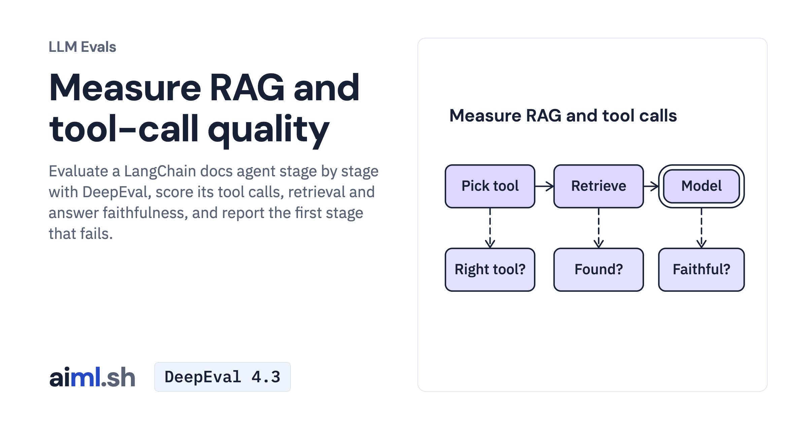

 [LLM Evals](../) · lesson 2 of 6

# Measure RAG and tool-call quality

[](https://aiml.sh/courses/llm-evaluation/measure-rag-and-tool-call-quality/)

Evaluate a LangChain docs agent stage by stage with DeepEval, score its tool calls, retrieval and answer faithfulness, and report the first stage that fails.

- **Full lesson:** [https://aiml.sh/courses/llm-evaluation/measure-rag-and-tool-call-quality/](https://aiml.sh/courses/llm-evaluation/measure-rag-and-tool-call-quality/)
- **Reading time:** 25 min
- **Uses:** DeepEval 4.3.1, LangChain 1.4.6, langchain-google-genai 4.4.2 and pytest 9.1.1; langchain-ollama 1.1.0 for the local alternative; pinned in requirements-lock.txt

## Lab

The [`lab/`](lab/) folder holds the complete runnable code, tests and recorded outputs, the same files as the lesson's download on aiml.sh. The lesson explains each step.

### Lab notes

#### Measure RAG and tool-call quality

Python 3.11 or later. Live runs call Gemini `gemini-3.8-flash` and `gemini-embedding-2` and need `GOOGLE_API_KEY`; replays and `test_evaluate.py` need no model and no key.

```bash
pip install -r requirements-lock.txt
export GOOGLE_API_KEY=...                  # live runs only
python evaluate.py --live                  # run the agent and the judge, record both, write runs/report.*
python evaluate.py                         # rebuild the report from the recording, no model call
python calibrate.py                        # replay the judge calibration (--live to rerun it)
python assistant.py "Is issue 212 fixed?"  # one live question
pytest -q test_evaluate.py                 # offline tests of the evaluation code
```

Local alternative: `ollama pull gemma4:e2b qwen3-embedding:0.6b`, then set `DOCS_MODEL=gemma4:e2b DOCS_EMBEDDER=qwen3-embedding:0.6b`. The judge stays `gemini-3.8-flash`; change `JUDGE_MODEL` in `evaluate.py` to judge locally too.

- `assistant.py`: the system under test, a LangChain agent with `search_docs` over an `InMemoryVectorStore` and `get_issue`.
- `docs.json`, `issues.json`: the documentation pages and issues the tools read. `cases.json`: the questions with expected tools, expected pages and a reference answer.
- `evaluate.py`: scores tools, retrieval and DeepEval's judged metrics per case and names the first failing stage.
- `calibrate.py` and `calibration-cases.json`: answers and contexts with a known defect, scored three times each.
- `cassette.py`: record/replay that refuses a recording whose key differs; `recording_key()` in `evaluate.py` hashes the cases, pages, issues and system prompt into the key. `recordings/` and `runs/`: the recorded traces, verdicts and reports.

`evaluate.py` and `calibrate.py` set `DEEPEVAL_TELEMETRY_OPT_OUT=1` to keep DeepEval from sending telemetry.
