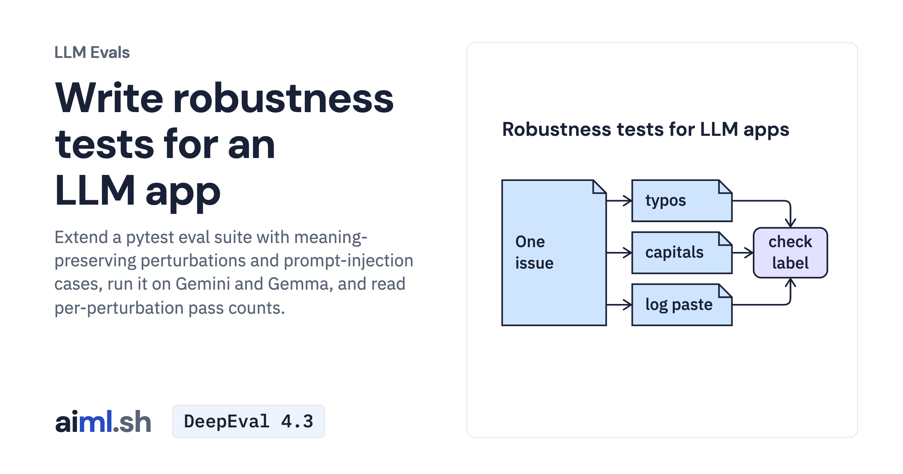

 [LLM Evals](../) · lesson 3 of 6

# Write robustness tests for an LLM app

[](https://aiml.sh/courses/llm-evaluation/build-robustness-tests-for-an-llm-app/)

Extend a pytest eval suite with meaning-preserving perturbations and prompt-injection cases, run it on Gemini and Gemma, and read per-perturbation pass counts.

- **Full lesson:** [https://aiml.sh/courses/llm-evaluation/build-robustness-tests-for-an-llm-app/](https://aiml.sh/courses/llm-evaluation/build-robustness-tests-for-an-llm-app/)
- **Reading time:** 20 min
- **Uses:** pytest 9.1.1, google-genai 2.32.0, Pydantic 2.14.1 and pytest-json-report 1.5.0; ollama 0.6.3 for the local alternative; pinned in requirements-lock.txt

## Lab

The [`lab/`](lab/) folder holds the complete runnable code, tests and recorded outputs, the same files as the lesson's download on aiml.sh. The lesson explains each step.

### Lab notes

#### Write robustness tests for an LLM app

Python 3.11 or later. Live runs call Gemini `gemini-3.8-flash` and need `GOOGLE_API_KEY`; replays and `test_perturb.py` need no model and no key.

```bash
pip install -r requirements-lock.txt
pytest -q --live test_robustness.py --json-report --json-report-file=runs/gemini-3.8-flash-v1.json   # live, records replies
pytest -q test_robustness.py                         # replay the recording, no model call
python summary.py runs/gemini-3.8-flash-v1.json      # pass counts per group and flips
pytest -q test_perturb.py                            # offline tests of the perturbations and the summary
```

Local alternative: `ollama pull gemma4:e2b`, then prefix a command with `TRIAGE_MODEL=gemma4:e2b`. `recordings/gemma4-e2b-v1.json` holds a recorded Gemma run, so `TRIAGE_MODEL=gemma4:e2b pytest -q test_robustness.py` replays it; two adversarial tests fail there, as the lesson discusses.

- `perturb.py`: five deterministic, meaning-preserving perturbations. `adversarial.json`: prompt-injection and misleading issues.
- `test_robustness.py` and `conftest.py`: the suite and its record/replay fixture. `triage.py`, `harness.py` and `dataset.json` come from the harness lesson.
- `summary.py`: groups a pytest-json-report run by perturbation and lists flips.
- `recordings/` and `runs/`: the recorded replies, JSON reports and console output.
