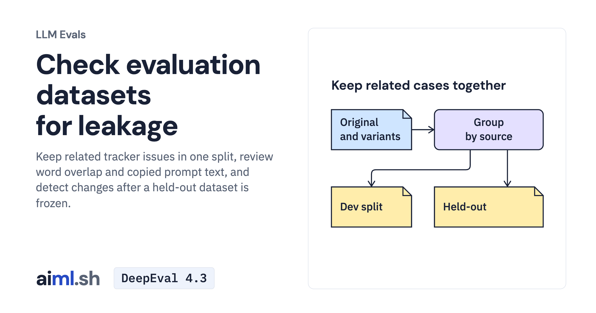

 [LLM Evals](../) · lesson 5 of 6

# Check evaluation datasets for leakage

[](https://aiml.sh/courses/llm-evaluation/build-held-out-dataset-and-leakage-checks/)

Keep related tracker issues in one split, review word overlap and copied prompt text, and detect changes after a held-out dataset is frozen.

- **Full lesson:** [https://aiml.sh/courses/llm-evaluation/build-held-out-dataset-and-leakage-checks/](https://aiml.sh/courses/llm-evaluation/build-held-out-dataset-and-leakage-checks/)
- **Reading time:** 22 min
- **Uses:** scikit-learn, Pydantic and pytest

## Lab

The [`lab/`](lab/) folder holds the complete runnable code, tests and recorded outputs, the same files as the lesson's download on aiml.sh. The lesson explains each step.

### Lab notes

#### Tracker evaluation split checks

The current lesson uses `tracker_leakcheck.py`, `split_models.py`, and
`record_tracker_splits.py`. `tracker-dataset.json` is an unchanged copy of the
published evaluation harness's fictional tracker issue set; `perturb.py` is
unchanged from the robustness lesson. The recorded split adds two shouting
variants and groups each with its original using scikit-learn.

```
python3 -m venv .venv
.venv/bin/python -m pip install -r tracker-requirements.txt
.venv/bin/python -m pytest -q test_tracker_splits.py
.venv/bin/python record_tracker_splits.py --check
.venv/bin/python tracker_leakcheck.py tracker-splits.json --lock tracker-heldout.lock.json
```

No model, network, or API key is needed after package installation. Running the
recorder without `--check` rewrites its three outputs. `tracker-split-run.json`
is a local deterministic run, not a model evaluation or an estimate of leakage
prevalence. Near word overlap and copied prompt excerpts request review; they
cannot establish how information reached an application. Exact normalized
cross-split inputs, explicit ancestry crossings, and frozen split edits block.
A pass does not establish unseen training data or detect semantic paraphrases.

The `legacy/` directory preserves the earlier inbox example and its saved files.
Use the tracker commands above for this lesson.
