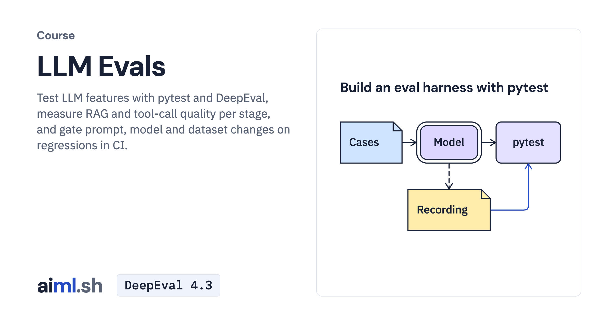

#  LLM Evals

Test LLM features with pytest and DeepEval, measure RAG and tool-call quality per stage, and gate prompt, model and dataset changes on regressions in CI.

- **Course on aiml.sh:** [https://aiml.sh/courses/llm-evaluation/](https://aiml.sh/courses/llm-evaluation/)
- **Lessons:** 6 · **Reading time:** about 2 hours
- **Prerequisites:** Python and pytest basics: test functions, assert and fixtures. Live runs use a Gemini API key or a local Ollama model; replaying the recorded runs needs neither.
- **Framework:** DeepEval 4.3

## What you'll learn

- Build a pytest eval harness with a versioned dataset, deterministic checks, a calibrated LLM-as-judge metric and record/replay for CI.
- Score an agent's tool calls, retrieval and grounded answers separately with DeepEval metrics, and name the stage that failed.
- Write perturbation and prompt-injection tests, and find flips that a single pass rate hides.
- Gate a prompt, model or dataset change on regressions in GitHub Actions, and refuse runs that can't be compared.
- Check dataset splits for leakage and match recorded cases and stages to a local release manifest.

## Lessons

| # | Lesson | Time | Code | Full lesson |
|---|---|---|---|---|
| 1 | [Build an eval harness with pytest](01-build-an-eval-harness/) | 25&nbsp;min | [lab](01-build-an-eval-harness/lab/) | [read](https://aiml.sh/courses/llm-evaluation/build-an-eval-harness/) |
| 2 | [Measure RAG and tool-call quality](02-measure-rag-and-tool-call-quality/) | 25&nbsp;min | [lab](02-measure-rag-and-tool-call-quality/lab/) | [read](https://aiml.sh/courses/llm-evaluation/measure-rag-and-tool-call-quality/) |
| 3 | [Write robustness tests for an LLM app](03-build-robustness-tests-for-an-llm-app/) | 20&nbsp;min | [lab](03-build-robustness-tests-for-an-llm-app/lab/) | [read](https://aiml.sh/courses/llm-evaluation/build-robustness-tests-for-an-llm-app/) |
| 4 | [Gate releases on eval regressions in CI](04-gate-releases-on-eval-regressions/) | 22&nbsp;min | [lab](04-gate-releases-on-eval-regressions/lab/) | [read](https://aiml.sh/courses/llm-evaluation/gate-releases-on-eval-regressions/) |
| 5 | [Check evaluation datasets for leakage](05-build-held-out-dataset-and-leakage-checks/) | 22&nbsp;min | [lab](05-build-held-out-dataset-and-leakage-checks/lab/) | [read](https://aiml.sh/courses/llm-evaluation/build-held-out-dataset-and-leakage-checks/) |
| 6 | [Bind an eval run to a release manifest](06-build-a-release-manifest-for-application-model-tokenizer-prompt-data-and-index-versions/) | 20&nbsp;min | [lab](06-build-a-release-manifest-for-application-model-tokenizer-prompt-data-and-index-versions/lab/) | [read](https://aiml.sh/courses/llm-evaluation/build-a-release-manifest-for-application-model-tokenizer-prompt-data-and-index-versions/) |

Each lesson folder has a short summary, its diagram and its lab. The complete lesson, with explanations, recorded results and checks, is on aiml.sh.

[Back to all courses](../../README.md#courses)
