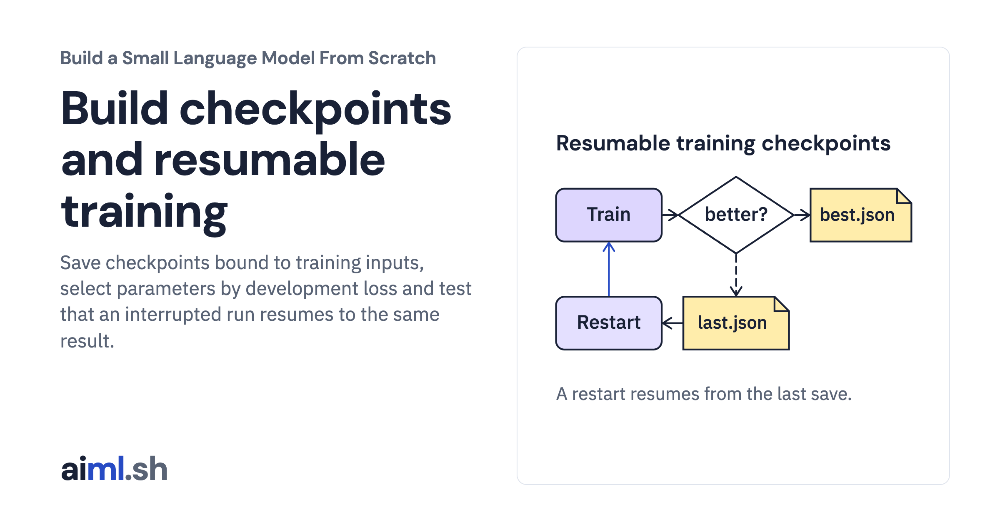

 [Build a Small Language Model From Scratch](../) · lesson 7 of 11

# Build checkpoints and resumable training

[](https://aiml.sh/courses/llm-from-scratch/build-checkpoints-and-resumable-training/)

Save checkpoints bound to training inputs, select parameters by development loss and test that an interrupted run resumes to the same result.

- **Full lesson:** [https://aiml.sh/courses/llm-from-scratch/build-checkpoints-and-resumable-training/](https://aiml.sh/courses/llm-from-scratch/build-checkpoints-and-resumable-training/)
- **Reading time:** 30 min
- **Uses:** Standard library only

## Lab

The [`lab/`](lab/) folder holds the complete runnable code, tests and recorded outputs, the same files as the lesson's download on aiml.sh. The lesson explains each step.

### Lab notes

#### Build checkpoints and resumable training

Python 3.10 or newer. This complete lab uses only the standard library; no API key,
model download, GPU or package installation is needed.

Extract the ZIP and open `build-checkpoints-and-resumable-training/`. On macOS/Linux:

```bash
python3 -m venv .venv
source .venv/bin/activate
python trace_checkpoints.py
python -m unittest -v test_checkpoint.py
```

On Windows, create the environment with `py -m venv .venv` and activate it with
`.venv\Scripts\Activate.ps1` in PowerShell. Keep all bundled Python modules,
corpus/tokenizer files and JSON fixtures together. Source panels in the lesson
import these files directly.

The `trace_*.py` programs print local results. `--check` compares deterministic
results with the bundled record; `--write` replaces that record. Timing varies
between runs and is recorded separately from deterministic checks.

The full checkpoint demonstration runs four short CPU training jobs; the bundled timing is about seven minutes. The unit tests use smaller jobs.

Run `python inspect_inputs.py` to inspect matching, changed and missing bundle identities without retraining. Use `--check` to compare the saved result.
