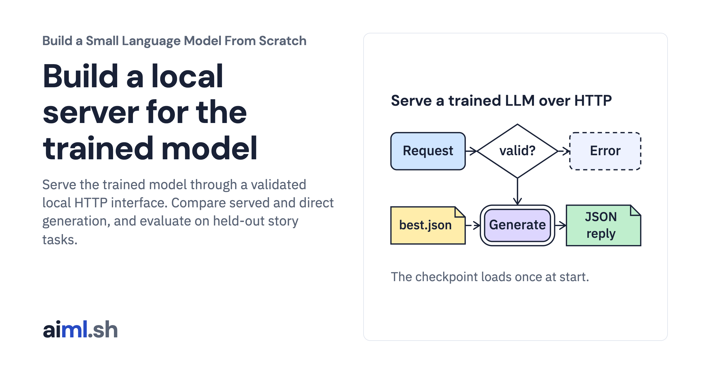

 [Build a Small Language Model From Scratch](../) · lesson 10 of 11

# Build a local server for the trained model

[](https://aiml.sh/courses/llm-from-scratch/build-a-server-for-your-trained-llm/)

Serve the trained model through a validated local HTTP interface. Compare served and direct generation, and evaluate on held-out story tasks.

- **Full lesson:** [https://aiml.sh/courses/llm-from-scratch/build-a-server-for-your-trained-llm/](https://aiml.sh/courses/llm-from-scratch/build-a-server-for-your-trained-llm/)
- **Reading time:** 30 min
- **Uses:** Standard library only

## Lab

The [`lab/`](lab/) folder holds the complete runnable code, tests and recorded outputs, the same files as the lesson's download on aiml.sh. The lesson explains each step.

### Lab notes

#### Build a server for your trained LLM

Python 3.10 or newer. This complete lab uses only the standard library; no API key,
model download, GPU or package installation is needed.

Extract the ZIP and open `build-a-server-for-your-trained-llm/`. On macOS/Linux:

```bash
python3 -m venv .venv
source .venv/bin/activate
python evaluate_service.py --check
python -m unittest -v test_server.py
```

On Windows, create the environment with `py -m venv .venv` and activate it with
`.venv\Scripts\Activate.ps1` in PowerShell. Keep all bundled Python modules,
corpus/tokenizer files and JSON fixtures together. Source panels in the lesson
import these files directly.

The `trace_*.py` programs print local results. `--check` compares deterministic
results with the bundled record; `--write` replaces that record. Timing varies
between runs and is recorded separately from deterministic checks.

Start `python server.py --port 8000` in Terminal 1. In Terminal 2 send `curl -s http://127.0.0.1:8000/health`. The teaching server binds to loopback and handles one request at a time; do not expose it as a public service.
