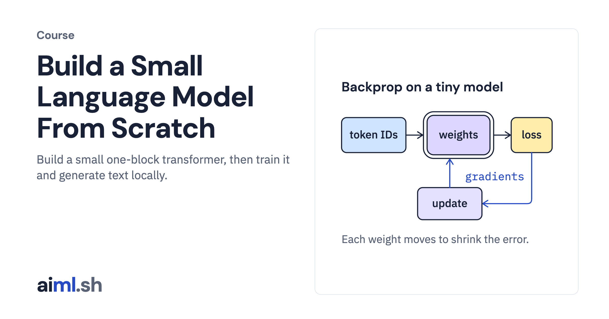

#  Build a Small Language Model From Scratch

Build a small one-block transformer, then train it and generate text locally.

- **Course on aiml.sh:** [https://aiml.sh/courses/llm-from-scratch/](https://aiml.sh/courses/llm-from-scratch/)
- **Lessons:** 11 · **Reading time:** about 5 hours
- **Prerequisites:** Python basics, elementary algebra and probabilities. The preparation guide below reviews the numerical ideas used in Lesson 1.

## What you'll learn

- Implement and inspect a training step, tokenizer, causal attention and transformer block.
- Train on bundled synthetic stories and bind resumable checkpoints to their inputs.
- Generate text with sampling, compare cached generation and validate a local HTTP interface.
- Port the one-block transformer to PyTorch and compare outputs and gradients within explicit numerical tolerances.

## Lessons

| # | Lesson | Time | Code | Full lesson |
|---|---|---|---|---|
| 1 | [Build one training step by hand](01-build-one-training-step-by-hand/) | 25&nbsp;min | [lab](01-build-one-training-step-by-hand/lab/) | [read](https://aiml.sh/courses/llm-from-scratch/build-one-training-step-by-hand/) |
| 2 | [Build a byte-pair encoding tokenizer](02-build-a-byte-pair-encoding-tokenizer/) | 25&nbsp;min | [lab](02-build-a-byte-pair-encoding-tokenizer/lab/) | [read](https://aiml.sh/courses/llm-from-scratch/build-a-byte-pair-encoding-tokenizer/) |
| 3 | [Build a next-token prediction baseline](03-build-a-next-token-prediction-baseline/) | 25&nbsp;min | [lab](03-build-a-next-token-prediction-baseline/lab/) | [read](https://aiml.sh/courses/llm-from-scratch/build-a-next-token-prediction-baseline/) |
| 4 | [Build causal self-attention and inspect intermediate outputs](04-build-causal-self-attention-and-inspect-intermediate-outputs/) | 30&nbsp;min | [lab](04-build-causal-self-attention-and-inspect-intermediate-outputs/lab/) | [read](https://aiml.sh/courses/llm-from-scratch/build-causal-self-attention-and-inspect-intermediate-outputs/) |
| 5 | [Build a transformer block with positional information](05-build-a-transformer-block-with-positional-information/) | 30&nbsp;min | [lab](05-build-a-transformer-block-with-positional-information/lab/) | [read](https://aiml.sh/courses/llm-from-scratch/build-a-transformer-block-with-positional-information/) |
| 6 | [Build a small language-model training pipeline](06-build-a-small-language-model-training-pipeline/) | 30&nbsp;min | [lab](06-build-a-small-language-model-training-pipeline/lab/) | [read](https://aiml.sh/courses/llm-from-scratch/build-a-small-language-model-training-pipeline/) |
| 7 | [Build checkpoints and resumable training](07-build-checkpoints-and-resumable-training/) | 30&nbsp;min | [lab](07-build-checkpoints-and-resumable-training/lab/) | [read](https://aiml.sh/courses/llm-from-scratch/build-checkpoints-and-resumable-training/) |
| 8 | [Build text generation with sampling controls](08-build-text-generation-with-sampling-controls/) | 25&nbsp;min | [lab](08-build-text-generation-with-sampling-controls/lab/) | [read](https://aiml.sh/courses/llm-from-scratch/build-text-generation-with-sampling-controls/) |
| 9 | [Build a KV cache for LLM generation](09-build-a-kv-cache-for-llm-generation/) | 25&nbsp;min | [lab](09-build-a-kv-cache-for-llm-generation/lab/) | [read](https://aiml.sh/courses/llm-from-scratch/build-a-kv-cache-for-llm-generation/) |
| 10 | [Build a local server for the trained model](10-build-a-server-for-your-trained-llm/) | 30&nbsp;min | [lab](10-build-a-server-for-your-trained-llm/lab/) | [read](https://aiml.sh/courses/llm-from-scratch/build-a-server-for-your-trained-llm/) |
| 11 | [Compare a handwritten transformer with PyTorch](11-compare-a-handwritten-transformer-with-pytorch/) | 30&nbsp;min | [lab](11-compare-a-handwritten-transformer-with-pytorch/lab/) | [read](https://aiml.sh/courses/llm-from-scratch/compare-a-handwritten-transformer-with-pytorch/) |

Each lesson folder has a short summary, its diagram and its lab. The complete lesson, with explanations, recorded results and checks, is on aiml.sh.

[Back to all courses](../../README.md#courses)
