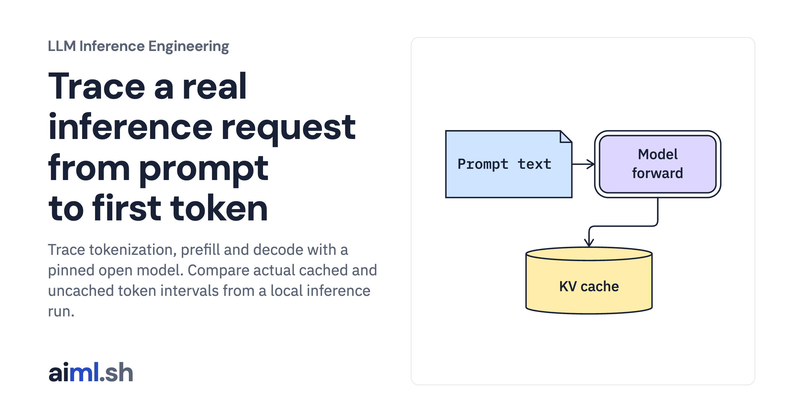

 [LLM Inference Engineering](../) · lesson 1 of 20

# Trace a real inference request from prompt to first token

[](https://aiml.sh/courses/llm-inference/trace-an-inference-request/)

Trace tokenization, prefill and decode with a pinned open model. Compare actual cached and uncached token intervals from a local inference run.

- **Full lesson:** [https://aiml.sh/courses/llm-inference/trace-an-inference-request/](https://aiml.sh/courses/llm-inference/trace-an-inference-request/)
- **Reading time:** 25 min
- **Uses:** Offline checks have no external imports; live model execution uses torch 2.14.1 and transformers 5.20.2

## Lab

The [`lab/`](lab/) folder holds the complete runnable code, tests and recorded outputs, the same files as the lesson's download on aiml.sh. The lesson explains each step.

### Lab notes

#### Trace a real inference request from prompt to first token

Fresh local inference with a pinned Apache-2.0 model. The default command analyzes its committed record offline; the separate live runner executes the model.

##### Run

Use Python 3.12 or later. From this directory:

```sh
python3 lab.py
python3 -m unittest -v test_lab.py
```

`LocalDecoder.run()` performs real forward passes, records each selected token, and synchronizes the device before recording timestamps. It explicitly sets greedy decoding, an output cap, the attention backend, and whether to retain the cache. `summarize()` rejects inconsistent timing records before calculating medians.

##### Interpretation

A longer prompt adds prefill work and cache state. Keeping KV state saves repeated computation but consumes memory for every active request. Disabling the cache changes both compute and allocation behavior; it is not a deployment recommendation. Device synchronization makes these stage timings interpretable but can slow the execution being measured.

##### Sources

- Transformers generation configuration: https://huggingface.co/docs/transformers/v5.20.2/en/main_classes/text_generation
- PyTorch MPS backend: https://docs.pytorch.org/docs/2.14/notes/mps.html
- Official model card and license: https://huggingface.co/Qwen/Qwen2.5-0.5B-Instruct/tree/7ae557604adf67be50417f59c2c2f167def9a775

##### Optional fresh execution

```sh
python3 -m venv .venv
.venv/bin/python -m pip install -r requirements-live.txt
.venv/bin/python download_model.py --destination ./model
.venv/bin/python live_inference.py --model-path ./model --device mps --output new-live-run.json
```

Run model commands in the pinned runtime from the first lesson. CPU and Metal results are distinct; no NVIDIA execution is claimed.
