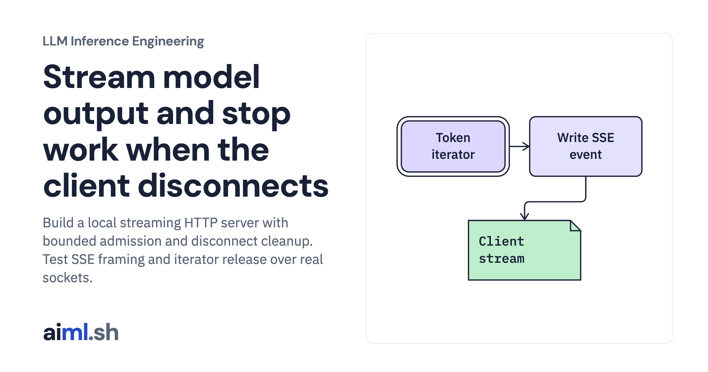

 [LLM Inference Engineering](../) · lesson 2 of 20

# Stream model output and stop work when the client disconnects

[](https://aiml.sh/courses/llm-inference/stream-tokens-over-sse-and-cancel-dropped-requests/)

Build a local streaming HTTP server with bounded admission and disconnect cleanup. Test SSE framing and iterator release over real sockets.

- **Full lesson:** [https://aiml.sh/courses/llm-inference/stream-tokens-over-sse-and-cancel-dropped-requests/](https://aiml.sh/courses/llm-inference/stream-tokens-over-sse-and-cancel-dropped-requests/)
- **Reading time:** 25 min
- **Uses:** Offline checks have no external imports; live model execution uses torch 2.14.1 and transformers 5.20.2

## Lab

The [`lab/`](lab/) folder holds the complete runnable code, tests and recorded outputs, the same files as the lesson's download on aiml.sh. The lesson explains each step.

### Lab notes

#### Stream model output and stop work when the client disconnects

Actual local HTTP implementation; controlled socket tests plus a separate real-model request record. No reverse proxy was deployed.

##### Run

Use Python 3.12 or later. From this directory:

```sh
python3 -m unittest -v test_server.py
python3 -m unittest -v test_server.py
```

`server.py` is an actual loopback HTTP server backed by the same local decoder as the first lesson. `test_server.py` exercises real sockets with a controlled text fixture, including a client disconnect. The fixture tests transport and cleanup; the separate HTTP run sends requests to the real model.

##### Interpretation

A synchronous model call per text event is simple to inspect but limits concurrency. This example admits one active model request and returns HTTP 429 for excess work. A production scheduler would multiplex admitted requests and propagate cancellation into its engine. A write failure detects many disconnects, but a silent stalled peer also needs deadlines and heartbeats.

##### Sources

- MDN SSE framing and closing connections: https://developer.mozilla.org/en-US/docs/Web/API/Server-sent_events/Using_server-sent_events
- Python HTTP server limitations: https://docs.python.org/3.12/library/http.server.html

##### Optional fresh execution

```sh
python3 -m venv .venv
.venv/bin/python -m pip install torch==2.14.1 transformers==5.20.2
.venv/bin/python server.py --model-path /path/to/downloaded/model --device mps --port 8766
```

Run model commands in the pinned runtime from the first lesson. CPU and Metal results are distinct; no NVIDIA execution is claimed.
