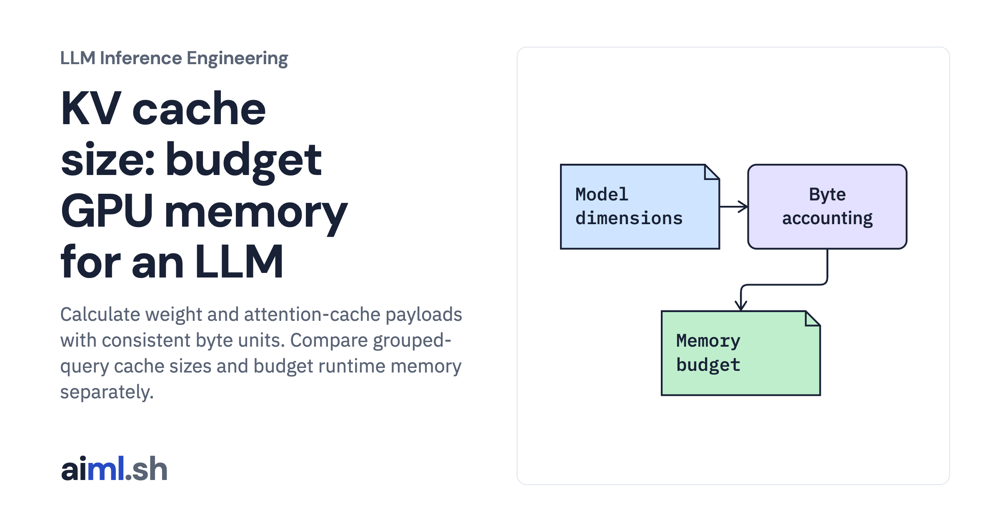

 [LLM Inference Engineering](../) · lesson 4 of 20

# Budget model weights, KV cache, and runtime memory

[](https://aiml.sh/courses/llm-inference/size-gpu-memory-for-model-weights-and-the-kv-cache/)

Calculate weight and attention-cache payloads with consistent byte units. Compare grouped-query cache sizes and budget runtime memory separately.

- **Full lesson:** [https://aiml.sh/courses/llm-inference/size-gpu-memory-for-model-weights-and-the-kv-cache/](https://aiml.sh/courses/llm-inference/size-gpu-memory-for-model-weights-and-the-kv-cache/)
- **Reading time:** 25 min
- **Uses:** Standard library only

## Lab

The [`lab/`](lab/) folder holds the complete runnable code, tests and recorded outputs, the same files as the lesson's download on aiml.sh. The lesson explains each step.

### Lab notes

#### Budget model weights, KV cache, and runtime memory

Executable capacity calculator with explicit example dimensions and workspace assumptions; not a GPU allocation or successful multi-GPU deployment.

##### Run

Use Python 3.12 or later. From this directory:

```sh
python3 lab.py
python3 -m unittest -v test_lab.py
```

`size_inference_memory()` computes the cache payload and reports decimal totals alongside clearly labeled binary quantities. Its example model dimensions are calculator fixtures. Compare them with the actual small-model configuration recorded in the first lesson; they are different workloads.

##### Interpretation

Lower cache precision can increase capacity, but requires supported kernels, scale storage, and quality checks. Reserving more space for active contexts leaves less room for prefill workspace and graph buffers. Planning from average context length misses a burst of unusually long documents.

##### Sources

- Transformers cache strategies: https://huggingface.co/docs/transformers/v5.20.2/en/kv_cache
- SGLang memory allocation tuning: https://docs.sglang.ai/advanced_features/hyperparameter_tuning.html
