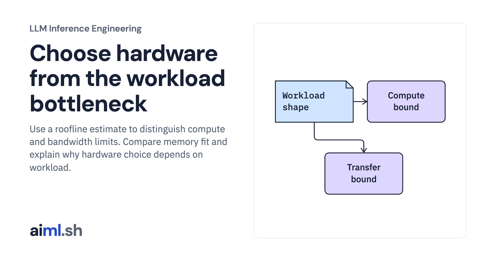

 [LLM Inference Engineering](../) · lesson 5 of 20

# Choose hardware from the workload bottleneck

[](https://aiml.sh/courses/llm-inference/choose-hardware-for-inference/)

Use a roofline estimate to distinguish compute and bandwidth limits. Compare memory fit and explain why hardware choice depends on workload.

- **Full lesson:** [https://aiml.sh/courses/llm-inference/choose-hardware-for-inference/](https://aiml.sh/courses/llm-inference/choose-hardware-for-inference/)
- **Reading time:** 25 min
- **Uses:** Standard library only

## Lab

The [`lab/`](lab/) folder holds the complete runnable code, tests and recorded outputs, the same files as the lesson's download on aiml.sh. The lesson explains each step.

### Lab notes

#### Choose hardware from the workload bottleneck

Generic roofline calculator. Device specifications and prices are hypothetical inputs; no accelerator ranking was measured.

##### Run

Use Python 3.12 or later. From this directory:

```sh
python3 lab.py
python3 -m unittest -v test_lab.py
```

`compute_prefill_metrics()` and `compute_decode_step_metrics()` estimate different phases, then check whether the weight and cache payload fits. Inspect `ModelWorkload` before comparing example device outputs. The first lesson’s real prefill/decode runs show the distinction without pretending to test these devices.

##### Interpretation

A faster arithmetic unit may do little for bandwidth-bound decode. More memory can increase concurrency without reducing single-request latency. Splitting weights across devices adds communication, so an aggregate bandwidth figure is not automatically usable by one request.

##### Sources

- NVIDIA roofline analysis guide: https://docs.nvidia.com/nsight-compute/ProfilingGuide/index.html
- Google Cloud inference optimization goals: https://docs.cloud.google.com/kubernetes-engine/docs/best-practices/machine-learning/inference
