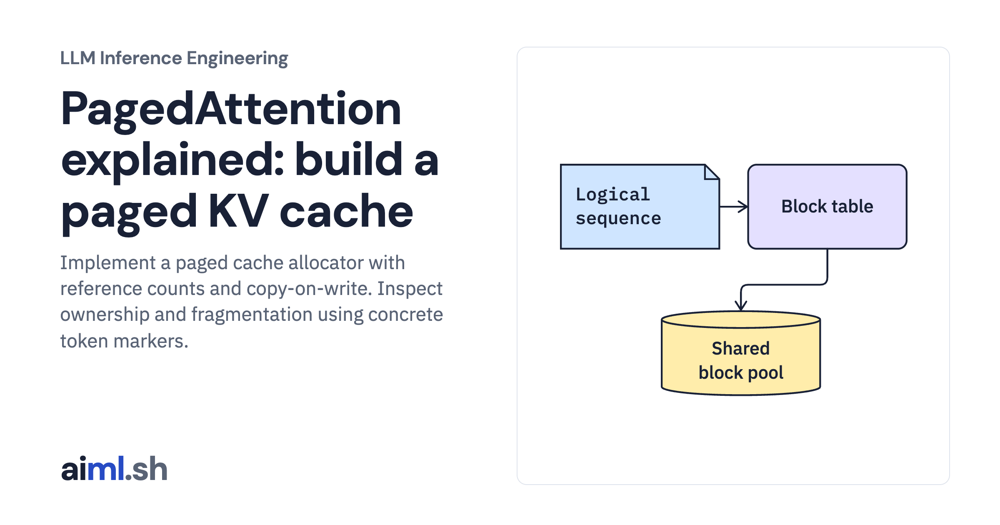

 [LLM Inference Engineering](../) · lesson 6 of 20

# Implement paged cache allocation and copy-on-write

[](https://aiml.sh/courses/llm-inference/stop-memory-waste-with-paged-kv-caching/)

Implement a paged cache allocator with reference counts and copy-on-write. Inspect ownership and fragmentation using concrete token markers.

- **Full lesson:** [https://aiml.sh/courses/llm-inference/stop-memory-waste-with-paged-kv-caching/](https://aiml.sh/courses/llm-inference/stop-memory-waste-with-paged-kv-caching/)
- **Reading time:** 25 min
- **Uses:** Standard library only

## Lab

The [`lab/`](lab/) folder holds the complete runnable code, tests and recorded outputs, the same files as the lesson's download on aiml.sh. The lesson explains each step.

### Lab notes

#### Implement paged cache allocation and copy-on-write

Actual CPU block allocator with inspectable token markers. It teaches ownership and paging; it does not execute a GPU attention kernel.

##### Run

Use Python 3.12 or later. From this directory:

```sh
python3 lab.py
python3 -m unittest -v test_lab.py
```

`PagedKvAllocator` implements block allocation, sequence forks, appends, reads, and release. Its stored values are token markers used to inspect ownership, not GPU key/value tensors. The tests exercise actual mutation and verify that one branch cannot overwrite its sibling.

##### Interpretation

Small blocks reduce tail slack but increase block-table and lookup overhead. Large blocks reduce metadata but waste more space for short tails. Prefix sharing saves memory until diverging branches need private blocks. A CPU allocator experiment does not measure GPU attention-kernel speed.

##### Sources

- vLLM paged-attention implementation: https://docs.vllm.ai/en/latest/design/paged_attention/
- PagedAttention authors’ implementation and paper: https://arxiv.org/abs/2309.06180
