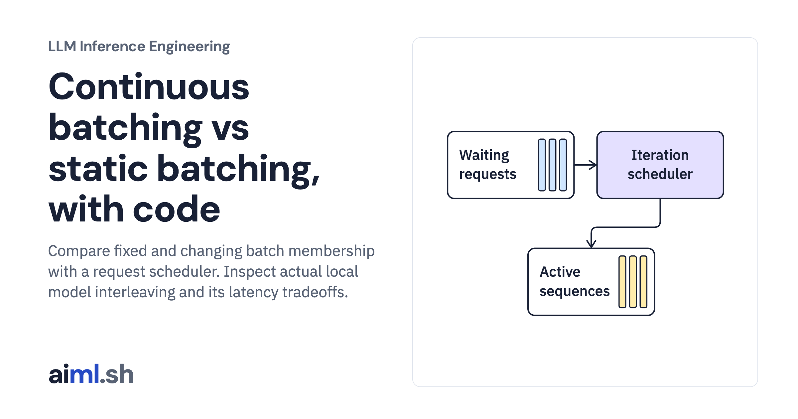

 [LLM Inference Engineering](../) · lesson 8 of 20

# Schedule requests between decode iterations

[](https://aiml.sh/courses/llm-inference/replace-static-batching-with-continuous-batching/)

Compare fixed and changing batch membership with a request scheduler. Inspect actual local model interleaving and its latency tradeoffs.

- **Full lesson:** [https://aiml.sh/courses/llm-inference/replace-static-batching-with-continuous-batching/](https://aiml.sh/courses/llm-inference/replace-static-batching-with-continuous-batching/)
- **Reading time:** 25 min
- **Uses:** Offline scheduler uses Python only; optional live execution uses torch 2.14.1 and transformers 5.20.2

## Lab

The [`lab/`](lab/) folder holds the complete runnable code, tests and recorded outputs, the same files as the lesson's download on aiml.sh. The lesson explains each step.

### Lab notes

#### Schedule requests between decode iterations

Executable discrete-event scheduler with a deterministic cost model. Real static-batch model measurements are linked separately; no engine integration is claimed.

##### Run

Use Python 3.12 or later. From this directory:

```sh
python3 lab.py
python3 -m unittest -v test_lab.py
```

`ContinuousBatchScheduler` handles admission and completion events, while `StaticBatchRunner` provides a baseline on the same request trace. The real-model batch sweep in the first lesson is static batching; it is not evidence that this scheduler was integrated into the model engine.

##### Interpretation

Admitting more work can raise total throughput while slowing each active request. New prefills also consume execution time, which motivates chunked prefill in the next lesson. Batch policy should follow the application: an overnight indexing job and an interactive code assistant need different latency targets.

##### Sources

- Transformers continuous batching: https://huggingface.co/docs/transformers/v5.20.2/en/continuous_batching
- SGLang throughput tuning: https://docs.sglang.ai/advanced_features/hyperparameter_tuning.html
