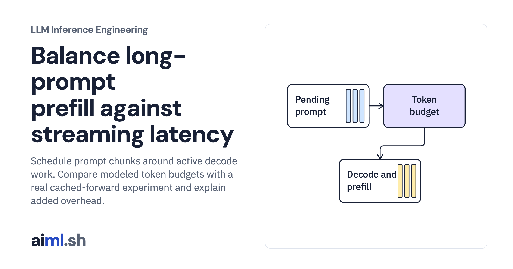

 [LLM Inference Engineering](../) · lesson 9 of 20

# Balance long-prompt prefill against streaming latency

[](https://aiml.sh/courses/llm-inference/fix-long-prompt-stalls-with-chunked-prefill/)

Schedule prompt chunks around active decode work. Compare modeled token budgets with a real cached-forward experiment and explain added overhead.

- **Full lesson:** [https://aiml.sh/courses/llm-inference/fix-long-prompt-stalls-with-chunked-prefill/](https://aiml.sh/courses/llm-inference/fix-long-prompt-stalls-with-chunked-prefill/)
- **Reading time:** 25 min
- **Uses:** Standard library only

## Lab

The [`lab/`](lab/) folder holds the complete runnable code, tests and recorded outputs, the same files as the lesson's download on aiml.sh. The lesson explains each step.

### Lab notes

#### Balance long-prompt prefill against streaming latency

Scheduler experiment plus linked real model chunked-forward timings. Only the scheduler model interleaves users; the local inference run is isolated.

##### Run

Use Python 3.12 or later. From this directory:

```sh
python3 lab.py
python3 -m unittest -v test_lab.py
```

`ChunkedPrefillScheduler` spends its iteration budget on active decodes and pending prompt chunks. `live_inference.py` in the first lab performs real chunked forwards with retained model cache. Compare these two execution modes before interpreting the results.

##### Interpretation

Optimizing streaming cadence can hurt long-prompt TTFT. A larger budget can improve throughput while increasing the longest gap between output tokens. Mean TPOT can conceal one visible pause; inspect individual inter-token gaps and the waiting time of the newly arrived interactive request.

##### Sources

- vLLM chunked-prefill scheduling and tradeoffs: https://docs.vllm.ai/en/latest/configuration/optimization/
- Transformers KV cache handling: https://huggingface.co/docs/transformers/v5.20.2/en/kv_cache
