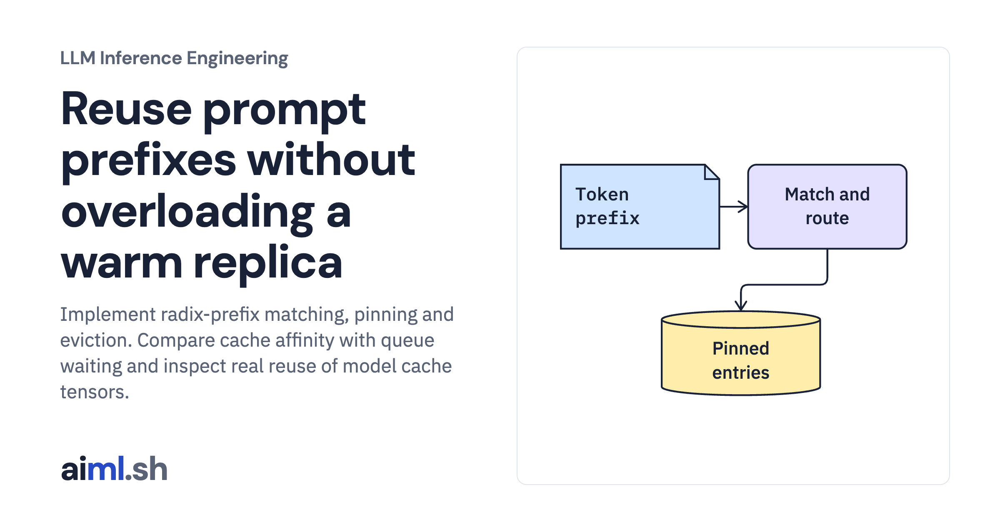

 [LLM Inference Engineering](../) · lesson 10 of 20

# Reuse prompt prefixes without overloading a warm replica

[](https://aiml.sh/courses/llm-inference/cache-shared-prompt-prefixes-and-route-to-warm-gpus/)

Implement radix-prefix matching, pinning and eviction. Compare cache affinity with queue waiting and inspect real reuse of model cache tensors.

- **Full lesson:** [https://aiml.sh/courses/llm-inference/cache-shared-prompt-prefixes-and-route-to-warm-gpus/](https://aiml.sh/courses/llm-inference/cache-shared-prompt-prefixes-and-route-to-warm-gpus/)
- **Reading time:** 25 min
- **Uses:** Standard library only

## Lab

The [`lab/`](lab/) folder holds the complete runnable code, tests and recorded outputs, the same files as the lesson's download on aiml.sh. The lesson explains each step.

### Lab notes

#### Reuse prompt prefixes without overloading a warm replica

Real CPU radix-tree implementation and routing experiment, with a linked actual model prefix-reuse comparison. No multi-GPU router was deployed.

##### Run

Use Python 3.12 or later. From this directory:

```sh
python3 lab.py
python3 -m unittest -v test_lab.py
```

`RadixKvTree` implements prefix matching, insertion, pinning, and eviction. `CacheAwareRouter` compares affinity and queue-aware choices. The real decoder splits one already-tokenized sequence before caching it, avoiding the assumption that separately tokenized text fragments concatenate identically.

##### Interpretation

Higher cache hit rate can coexist with worse end-to-end latency. Routing to a colder but less busy replica can be faster. Cross-tenant reuse also needs an isolation policy and model/configuration identity; token equality alone is not an authorization check.

##### Sources

- vLLM automatic prefix caching and limits: https://docs.vllm.ai/en/latest/features/automatic_prefix_caching/
- vLLM prefix-cache design and isolation: https://docs.vllm.ai/en/latest/design/prefix_caching/
