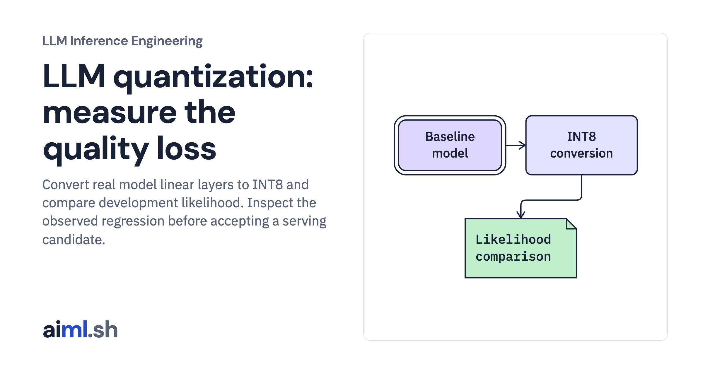

 [LLM Inference Engineering](../) · lesson 11 of 20

# Quantize a model and evaluate the regression

[](https://aiml.sh/courses/llm-inference/evaluate-model-quantization/)

Convert real model linear layers to INT8 and compare development likelihood. Inspect the observed regression before accepting a serving candidate.

- **Full lesson:** [https://aiml.sh/courses/llm-inference/evaluate-model-quantization/](https://aiml.sh/courses/llm-inference/evaluate-model-quantization/)
- **Reading time:** 25 min
- **Uses:** Offline checks have no external imports; live model execution uses torch 2.14.1 and transformers 5.20.2

## Lab

The [`lab/`](lab/) folder holds the complete runnable code, tests and recorded outputs, the same files as the lesson's download on aiml.sh. The lesson explains each step.

### Lab notes

#### Quantize a model and evaluate the regression

Fresh CPU INT8 model execution and recorded development-text likelihoods. Separate scalar quantization examples do not execute GPU quantized kernels.

##### Run

Use Python 3.12 or later. From this directory:

```sh
python3 lab.py
python3 -m unittest -v test_lab.py
```

`quantize_live.py` loads the pinned model, scores the same development texts, converts real linear modules, and records the new scores. It uses a pinned legacy PyTorch quantization API whose deprecation warning is preserved in the run notes; it is an investigation of a candidate, not a recommended new deployment API.

##### Interpretation

A smaller representation is useful only if the runtime executes it efficiently and the application accepts its output quality. This experiment produced a regression; the candidate is not accepted. CPU quantization results do not establish FP8 or INT4 behavior on a GPU. The separate scalar-format experiment remains a way to inspect rounding, not to benchmark those formats.

##### Sources

- PyTorch quantization documentation and migration notice: https://docs.pytorch.org/docs/2.14/quantization.html
- vLLM quantization compatibility: https://docs.vllm.ai/en/latest/features/quantization/
- Official model configuration: https://huggingface.co/Qwen/Qwen2.5-0.5B-Instruct/blob/7ae557604adf67be50417f59c2c2f167def9a775/config.json

##### Optional fresh execution

```sh
python3 -m venv .venv
.venv/bin/python -m pip install -r requirements-live.txt
.venv/bin/python quantize_live.py --model-path /path/to/downloaded/model --output new-quantization-run.json
```

Run model commands in the pinned runtime from the first lesson. CPU and Metal results are distinct; no NVIDIA execution is claimed.
