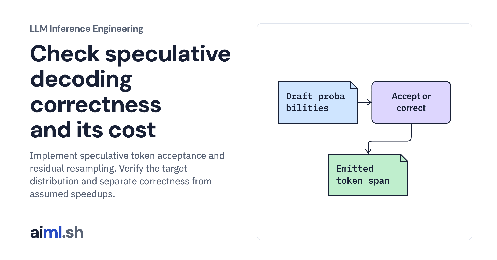

 [LLM Inference Engineering](../) · lesson 12 of 20

# Check speculative decoding correctness and its cost

[](https://aiml.sh/courses/llm-inference/use-speculative-decoding-and-know-when-it-hurts/)

Implement speculative token acceptance and residual resampling. Verify the target distribution and separate correctness from assumed speedups.

- **Full lesson:** [https://aiml.sh/courses/llm-inference/use-speculative-decoding-and-know-when-it-hurts/](https://aiml.sh/courses/llm-inference/use-speculative-decoding-and-know-when-it-hurts/)
- **Reading time:** 25 min
- **Uses:** Standard library only

## Lab

The [`lab/`](lab/) folder holds the complete runnable code, tests and recorded outputs, the same files as the lesson's download on aiml.sh. The lesson explains each step.

### Lab notes

#### Check speculative decoding correctness and its cost

Actual probability-correction implementation with explicit vectors, plus an assumed latency model. No draft/target model pair was benchmarked.

##### Run

Use Python 3.12 or later. From this directory:

```sh
python3 lab.py
python3 -m unittest -v test_lab.py
```

`verify_speculative_draft()` implements acceptance, correction, and the all-accepted bonus-token path. `marginal_output_distribution()` independently checks the distribution in a small vocabulary. The latency sweep is an explicit cost model, not a run of a draft and target LLM.

##### Interpretation

Longer drafts can amortize target work, but waste more work when acceptance is low. At larger batches, target verification may already be compute-limited, reducing the benefit. Draft cache memory and synchronization add cost. A speedup estimate alone cannot select a production draft model.

##### Sources

- vLLM speculative decoding and limitations: https://docs.vllm.ai/en/latest/features/speculative_decoding/
- Speculative sampling algorithm authors: https://arxiv.org/abs/2211.17192
