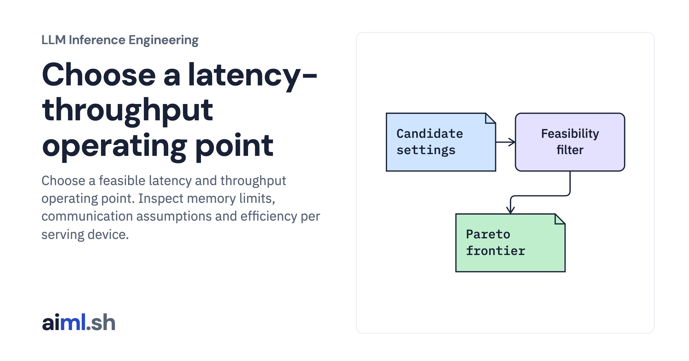

 [LLM Inference Engineering](../) · lesson 13 of 20

# Choose a latency-throughput operating point

[](https://aiml.sh/courses/llm-inference/choose-a-latency-throughput-operating-point/)

Choose a feasible latency and throughput operating point. Inspect memory limits, communication assumptions and efficiency per serving device.

- **Full lesson:** [https://aiml.sh/courses/llm-inference/choose-a-latency-throughput-operating-point/](https://aiml.sh/courses/llm-inference/choose-a-latency-throughput-operating-point/)
- **Reading time:** 25 min
- **Uses:** Standard library only

## Lab

The [`lab/`](lab/) folder holds the complete runnable code, tests and recorded outputs, the same files as the lesson's download on aiml.sh. The lesson explains each step.

### Lab notes

#### Choose a latency-throughput operating point

Constraint and Pareto-selection code over an assumed multi-device cost model; linked real static-batch timings use a single local model.

##### Run

Use Python 3.12 or later. From this directory:

```sh
python3 lab.py
python3 -m unittest -v test_lab.py
```

`pareto_frontier()` compares feasible configurations and `select_pareto_config()` applies the latency cap. The real static-batch sweep in the first lab is a separate measured example; the multi-device sweep here is unmeasured.

##### Interpretation

Lower TPOT can consume more devices per request and reduce throughput per device. Larger batches may raise throughput while worsening latency or exceeding memory. Never optimize a fleet solely by a single-request decode time or an aggregate tokens-per-second figure.

##### Sources

- NVIDIA inference benchmarking workflow: https://developer.nvidia.com/blog/llm-inference-benchmarking-performance-tuning-with-tensorrt-llm/
- vLLM parallelism tradeoffs: https://docs.vllm.ai/en/latest/configuration/optimization/
