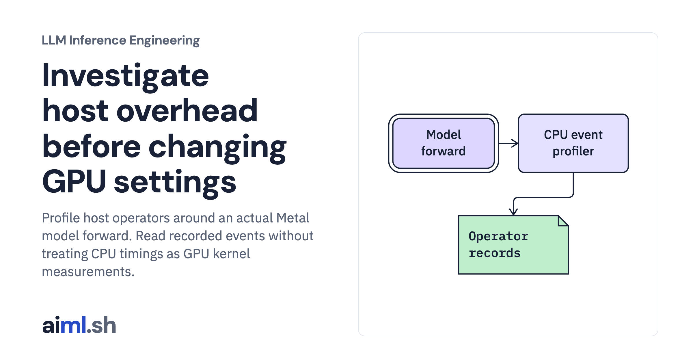

 [LLM Inference Engineering](../) · lesson 14 of 20

# Investigate host overhead before changing GPU settings

[](https://aiml.sh/courses/llm-inference/profile-inference-host-overhead/)

Profile host operators around an actual Metal model forward. Read recorded events without treating CPU timings as GPU kernel measurements.

- **Full lesson:** [https://aiml.sh/courses/llm-inference/profile-inference-host-overhead/](https://aiml.sh/courses/llm-inference/profile-inference-host-overhead/)
- **Reading time:** 25 min
- **Uses:** Offline checks have no external imports; live model execution uses torch 2.14.1 and transformers 5.20.2

## Lab

The [`lab/`](lab/) folder holds the complete runnable code, tests and recorded outputs, the same files as the lesson's download on aiml.sh. The lesson explains each step.

### Lab notes

#### Investigate host overhead before changing GPU settings

Actual CPU profiler events around Metal inference, plus a separate hypothetical timeline calculator. No NVIDIA utilization, occupancy, or CUDA graph result is claimed.

##### Run

Use Python 3.12 or later. From this directory:

```sh
python3 lab.py
python3 -m unittest -v test_lab.py
```

`profile_live.py` records actual operator names, call counts, host-side durations, and total profiled wall time. `diagnose_low_gpu_utilization()` separately explores explicit hypothetical timelines. Use each for the question it can answer.

##### Interpretation

Profiling adds overhead and can alter execution. Moving tokenization into a worker pool may improve request overlap but add coordination costs. Capturing a CUDA graph can reduce repeated launch overhead on a supported NVIDIA runtime, but it does not fix every memory or scheduling bottleneck and was not executed here.

##### Sources

- PyTorch profiler API: https://docs.pytorch.org/docs/2.14/profiler.html
- NVIDIA compute triage workflow: https://docs.nvidia.com/nsight-compute/ComputeTriage/index.html
- Nsight Systems CUDA trace: https://docs.nvidia.com/nsight-systems/UserGuide/index.html

##### Optional fresh execution

```sh
python3 -m venv .venv
.venv/bin/python -m pip install -r requirements-live.txt
.venv/bin/python profile_live.py --model-path /path/to/downloaded/model --output new-profile-run.json
```

Run model commands in the pinned runtime from the first lesson. CPU and Metal results are distinct; no NVIDIA execution is claimed.
